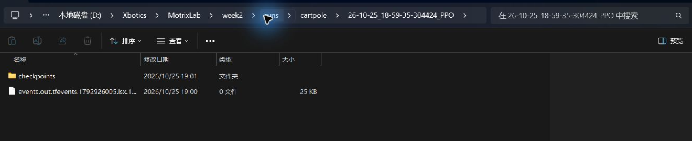
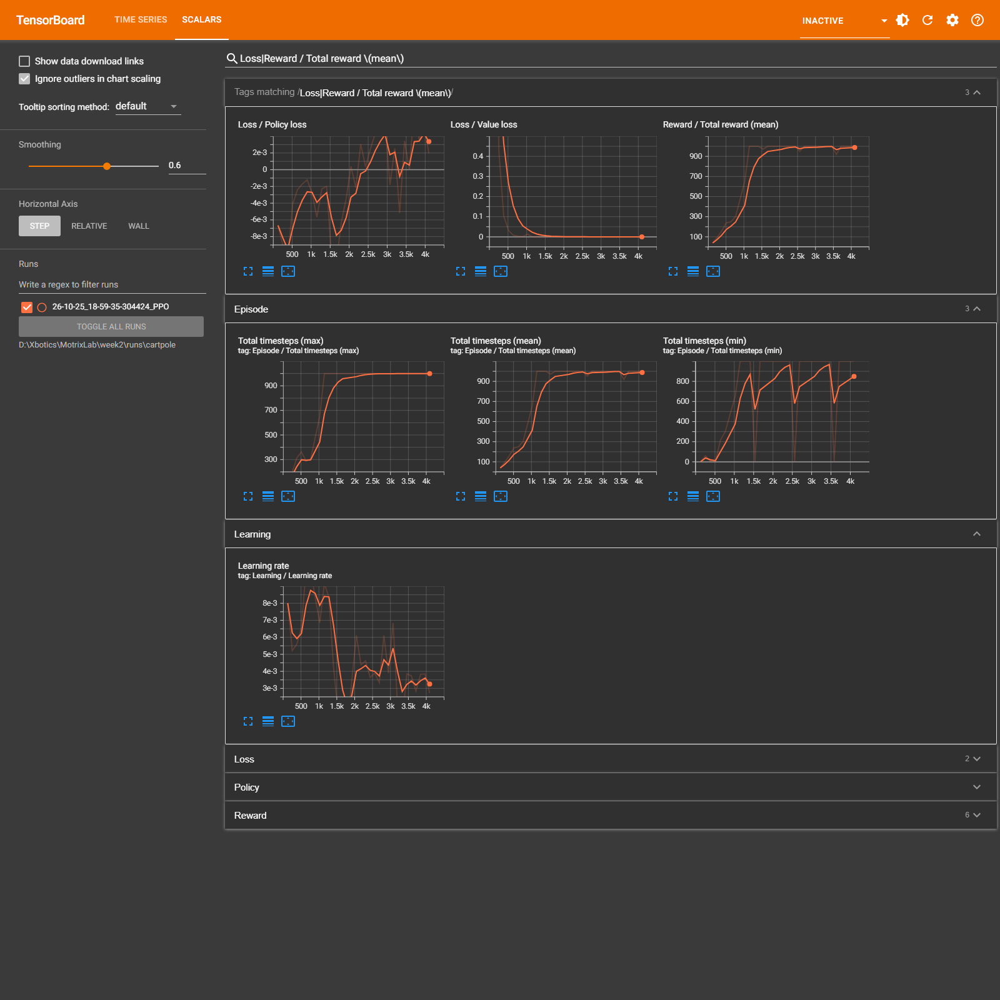
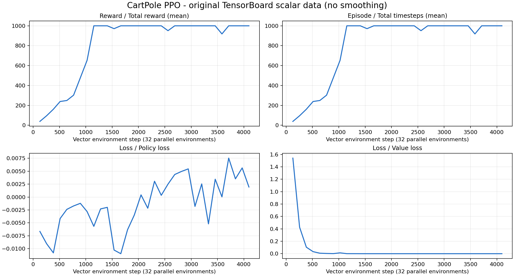
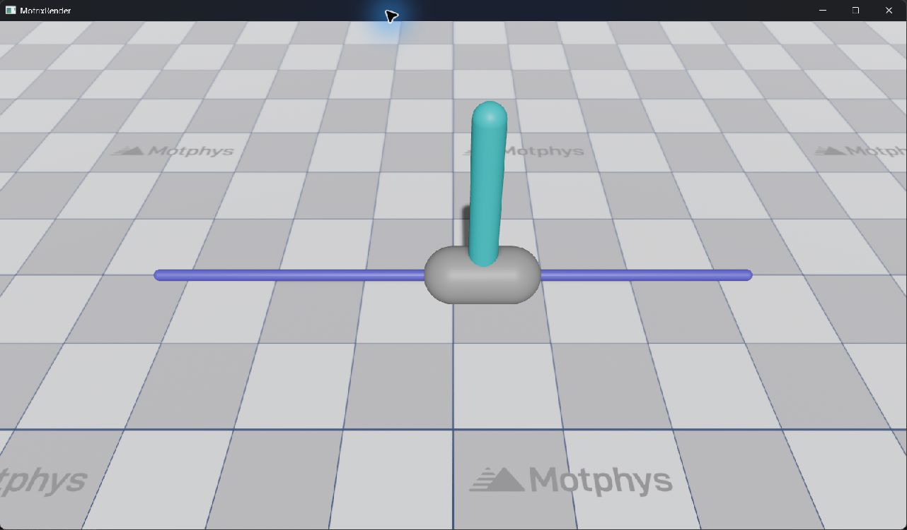

# 第五期课后第二周作业答案

范围：第 5–7 讲。选择题按题目所述课程接口作答；第 6 讲附可运行代码，第 7 讲附本机实际训练、TensorBoard、推理证据。

## 一、第 5 讲：配置系统（25 分）

### 选择题（10 分）

| 题号 | 答案 | 理由 |
| --- | --- | --- |
| 1 | **B** | `EnvCfg` 属于 `motrix_envs`，描述仿真和任务，与采用哪种 RL 算法无关。 |
| 2 | **C** | `max_episode_seconds` 规定任务回合的最长仿真时间，属于环境配置。 |
| 3 | **D** | `num_envs` 属于 `BaseRLCfg`，用于确定训练的并行环境数。 |
| 4 | **B** | `PPOCfg` 继承 `BaseRLCfg`，增加 PPO 专用超参数。 |
| 5 | **B** | 装饰器将 `EnvCfg` 子类以 `"cartpole"` 为键注册到环境注册表。 |
| 6 | **C** | 不存在的覆盖字段通过 `hasattr` 检查时失败，抛出 `ValueError`。 |
| 7 | **B** | `rlcfg.replace(**cfg_override)` 返回覆盖后的新配置对象。 |
| 8 | **A** | `--num-envs` 经训练配置 override 写入 `PPOCfg.num_envs`。 |
| 9 | **A** | 使用 `--env` 选择另一个已注册任务，从注册表取得该任务的环境和 RL 默认配置。 |
| 10 | **B** | 用配置子类保存默认值，用环境名/后端区分组合，用 override 表达少量动态差异。 |

### 应用题 (a)：字段归类（8 分）

| 字段 | 归属 | 用途 |
| --- | --- | --- |
| `model_file` | `EnvCfg` | 仿真模型文件路径。 |
| `sim_dt` | `EnvCfg` | 物理仿真时间步长。 |
| `render_spacing` | `EnvCfg` | 多环境渲染时的显示间距。 |
| `max_episode_seconds` | `EnvCfg` | 一个回合的最长仿真时间。 |
| `learning_rate` | `RLCfg` / `PPOCfg` | 优化器学习率。 |
| `num_envs` | `RLCfg` / `BaseRLCfg` | 训练时并行采样的环境数。 |
| `rollouts` | `RLCfg` / `PPOCfg` | 每轮更新前，各环境收集的经验步数。 |
| `ratio_clip` | `RLCfg` / `PPOCfg` | PPO 概率比裁剪范围。 |

环境侧 4 个，训练侧 4 个。`num_envs` 虽然会传给环境构造函数，但它在训练入口中由 RL 配置管理，并不是 `EnvCfg` 的字段。

### 应用题 (b)：找错和修改（7 分）

在 `"my-env"` 已注册、对应配置类没有 `not_exist_param` 属性的前提下，代码抛出 **`ValueError`**，不能创建环境。

`registry.make()` 先实例化环境配置，再逐项处理 `env_cfg_override`。核心检查为：

```python
for key, value in env_cfg_override.items():
    if hasattr(env_cfg, key):
        setattr(env_cfg, key, value)
    else:
        raise ValueError(
            f"Config class '{env_cfg.__class__.__name__}' has no attribute '{key}'"
        )
```

这里 `hasattr(env_cfg, "not_exist_param")` 为 `False`，异常发生在 `validate()`、后端选择和环境构造之前，不会静默忽略，也不会自动补字段。

若 `"my-env"` 根本没有注册，则会更早因为环境名不存在而抛出 `ValueError`；这与本题的非法字段错误是两种不同情况。

**改法一：覆盖已有字段。** 例如 `max_episode_seconds` 是真实环境字段：

```python
env = registry.make(
    name="my-env",
    sim_backend="np",
    num_envs=256,
    env_cfg_override={"max_episode_seconds": 2.0},
)
```

**改法二：确实需要新参数时，先在该环境的 `EnvCfg` 子类中声明字段，并让环境实现使用它。** 不能把学习率等 RL 字段塞进 `env_cfg_override`。

## 二、第 6 讲：注册系统（35 分）

### 选择题（10 分）

| 题号 | 答案 | 理由 |
| --- | --- | --- |
| 1 | **A** | `motrix_envs.registry` 管环境配置和环境实现；`motrix_rl.registry` 管 RL 配置。 |
| 2 | **B** | 带 `sim_backend`、`env_cfg_override`、`num_envs` 的 `make()` 属于环境注册表。 |
| 3 | **B** | 返回 cartpole 在 `skrl/jax` 组合下的默认训练配置实例。 |
| 4 | **C** | 按课程创建流程，`make()` 实例化配置、应用 override 后调用 `validate()`。 |
| 5 | **B** | 注册配置类时写入 `EnvMeta`，尚不创建环境或执行训练。 |
| 6 | **A** | 必须先注册配置，再注册环境实现；顺序指模块执行/导入顺序。 |
| 7 | **A** | NumPy 环境子类必须提供 `apply_action`、`update_state`、`reset`。 |
| 8 | **B** | 没有 import，模块不会被执行，装饰器也不会注册新任务。 |
| 9 | **C** | 省略 `backend` 时，同一个 RL 配置类注册到 `skrl/jax` 和 `skrl/torch`。 |
| 10 | **A** | `@envcfg`、`@env`、`@rlcfg` 的环境名都要写成 `"simple_walker"`。 |

第 4 题的“只在”理解为题目描述的框架调用路径；用户当然也可以显式调用 `cfg.validate()`。第 6 题是先执行配置类注册、再执行环境类注册，并不是给同一个类同时叠加两个装饰器。

### 应用题 (a)：配置类（8 分）

目标位置：`motrix_envs/src/motrix_envs/basic/simple_walker/cfg.py`。

```python
from dataclasses import dataclass
from motrix_envs import registry
from motrix_envs.base import EnvCfg
from motrix_envs.basic.walker.cfg import WalkerEnvCfg


@registry.envcfg("simple_walker")
@dataclass
class SimpleWalkerEnvCfg(EnvCfg):
    model_file: str = WalkerEnvCfg().model_file
    sim_dt: float = 0.0125
    ctrl_dt: float = 0.025
    max_episode_seconds: float = 10.0
    render_spacing: float = 2.0

    stand_height: float = 1.2       # 站立奖励的目标躯干高度，单位 m。
    move_speed: float = 1.0         # 前进奖励的目标速度，单位 m/s。
    reset_noise_scale: float = 0.01 # 初始关节位置和速度的随机扰动幅度。
```

这里复用官方 Walker 模型，创建独立注册的任务，避免虚构一个不存在的模型路径。三个任务特有字段均在实际实现中使用：前两个交给官方 Walker 奖励逻辑，第三个用于本题的 `reset()`。

完整文件：[cfg.py](code/motrix_envs/basic/simple_walker/cfg.py)。

### 应用题 (b)：环境实现（8 分）

完整装饰器写法：

```python
@registry.env("simple_walker", sim_backend="np")
class SimpleWalkerEnv(Walker2DEnv):
    ...
```

`Walker2DEnv` 是官方 `NpEnv` 的具体子类；复用它的动作写入、观测构造和奖励计算，并覆盖重置逻辑。必须实现的方法及契约如下：

```python
def apply_action(self, actions, state):
    # 向 state.data.actuator_ctrls 写入动作，返回 NpEnvState。
    return super().apply_action(actions, state)

def update_state(self, state):
    # 物理步后更新 obs、reward、terminated，返回 NpEnvState。
    return super().update_state(state)

def reset(self, data):
    # 重置传入的已结束环境子批次，而不是重置所有环境。
    # 返回 (obs, info)。
    ...
```

作答文件中的 `reset()` 已实现模型默认姿态、位置/速度扰动、正向运动学和奖励信息初始化，没有保留 `...` 或 `NotImplementedError`。

完整文件：[simple_walker_np.py](code/motrix_envs/basic/simple_walker/simple_walker_np.py)。

### 应用题 (c)：import 链与 RL 注册（6 分）

**第一处：任务包的 `__init__.py`**，即 `motrix_envs/src/motrix_envs/basic/simple_walker/__init__.py`：

```python
# 先执行配置注册，再执行环境实现注册。
from . import cfg, simple_walker_np  # noqa: F401
```

**第二处：分类包的 `__init__.py`**，即 `motrix_envs/src/motrix_envs/basic/__init__.py`，保留原有 import，再添加：

```python
from . import simple_walker  # noqa: F401
```

上层 `motrix_envs/__init__.py` 已经导入 `basic`，因此链路为：

```text
import motrix_envs
  -> basic/__init__.py
  -> simple_walker/__init__.py
  -> cfg.py                 执行 @envcfg("simple_walker")
  -> simple_walker_np.py    执行 @env("simple_walker", "np")
```

**RL 侧：在 `motrix_rl/src/motrix_rl/cfgs.py` 注册同名配置**：

```python
from dataclasses import dataclass
from motrix_rl.registry import rlcfg
from motrix_rl.skrl.cfg import PPOCfg


@rlcfg("simple_walker")
@dataclass
class SimpleWalkerPPOCfg(PPOCfg):
    seed: int = 42
    num_envs: int = 32
    play_num_envs: int = 1
    max_env_steps: int = 32 * 1024
    check_point_interval: int = 128
    policy_hidden_layer_sizes: tuple[int, ...] = (32, 32)
    value_hidden_layer_sizes: tuple[int, ...] = (32, 32)
    rollouts: int = 32
    learning_epochs: int = 4
    mini_batches: int = 4
    learning_rate: float = 3e-4
```

`motrix_rl/__init__.py` 已导入 `cfgs`；添加上述类即可使装饰器执行。`cfgs.py` 中原本已有的同名 import 不必重复添加。完整代码见 [simple_walker_rlcfg.py](code/simple_walker_rlcfg.py)。

### 应用题 (d)：验证命令（3 分）

在已安装依赖的 MotrixLab v0.2.0 源码根目录运行：

```bash
uv run --no-sync scripts/train.py --env simple_walker --sim-backend np --train-backend torch --num-envs 4 --seed 42
```

接入代码可通过以下脚本一次安装，参数是官方源码的根目录：

```bash
python /path/to/week2/code/install_simple_walker.py /path/to/MotrixLab
```

**实际验证结果：**注册表找到 `SimpleWalkerEnvCfg` 和 `np` 后端；4 个并行环境的观测为 `(4, 22)`，动作为每环境 `(6,)`；420 次步进中完成 4 个回合，观测和奖励均为有限数值。上述训练命令也已正常执行完 **8192 个批量步、32768 条环境转移**，日志见 [simple_walker_smoke.log](evidence/simple_walker_smoke.log)、[simple_walker_train.log](evidence/simple_walker_train.log)，训练产物在 [runs/simple_walker](runs/simple_walker/)。这是框架接入与训练闭环验证，不据此声称 Walker 已学会稳定行走。

## 三、第 7 讲：训练流程（40 分）

### 选择题（10 分）

| 题号 | 答案 | 理由 |
| --- | --- | --- |
| 1 | **B** | 按题目课程口径，使用 `--env` 明确指定训练任务。 |
| 2 | **C** | 按题目课程口径，使用 NumPy 仿真后端 `np`。 |
| 3 | **B** | 构造 `Trainer` 时先取默认 RL 配置并 replace；调用 `train()` 时再创建环境。 |
| 4 | **A** | 查注册表 → 实例化配置 → override → validate → 选后端 → 构造环境。 |
| 5 | **C** | wrapper 将 `NpEnv` 适配为 SKRL 的 `reset/step` 接口，并处理 NumPy/Torch 等数据转换。 |
| 6 | **B** | 并行采样 `num_envs` 个环境，积累 `rollouts` 步，再按 `learning_epochs` 和 mini-batch 更新。 |
| 7 | **C** | `get_log_dir(env_name)` 返回 `runs/{env_name}`。 |
| 8 | **A** | JAX 的 checkpoint 后缀为 `.pickle`；Torch 对应 `.pt`。 |
| 9 | **B** | 在最近一次训练目录的 `checkpoints` 中优先找 `best_agent.*`。 |
| 10 | **C** | 加载权重后执行 `act → step → render` 循环。 |

**版本差异说明：**实操固定使用官方 **v0.2.0**，提交 `c84d382b8c907e0ec288db4437339b43e9201494`。该版本的 `scripts/train.py` 实际将 `--env` 默认设为 `cartpole`，并非语法上的必填项；`--sim-backend` 的参数默认值为 `None`，由注册表自动选择首个可用后端，本次是 `np`。因此第 1、2 题按课程预期分别填 **B、C**；若严格询问该运行版本的参数定义，第 1 题没有“必填”选项，第 2 题也没有“None/自动选择”的选项。实操命令显式写出两者以避免歧义。

### 实操题：CartPole 训练闭环（30 分）

#### 运行环境与训练命令

日期：2026-10-25（Asia/Shanghai）。Windows x86_64、Python 3.10.20、MotrixLab v0.2.0、MotrixSim 0.6.0b1、SKRL 1.4.3、PyTorch 2.7.0+cpu、TensorBoard 2.21.0。使用 Torch CPU 训练，仿真后端为 `np`，随机种子为 42。

使用官方 `Trainer`，通过课程介绍的 `cfg_override` 缩短训练，使实验可在 CPU 上完成。入口代码为 [train_cartpole.py](code/train_cartpole.py)：

```python
trainer = Trainer(
    "cartpole",
    sim_backend="np",
    enable_render=False,
    cfg_override={
        "num_envs": 32,
        "play_num_envs": 1,
        "seed": 42,
        "max_env_steps": 32 * 4096,
        "check_point_interval": 128,
    },
)
trainer.train()
```

在官方源码根目录、使用安装好依赖的虚拟环境运行：

```bash
uv run --no-sync /path/to/week2/code/train_cartpole.py
```

实际执行 4096 个批量步，32 个并行环境，合计 **131072 条环境转移**；每 32 步进行一次 PPO 更新，共 **128 轮更新**。每 128 个批量步写日志/保存 checkpoint。训练正常返回，原始日志末尾含 `TRAINING_COMPLETED`，见 [train.log](evidence/train.log)。

#### 证据 1：输出目录（8 分）

本次实验生成的原始目录已完整复制到作业中：

```text
week2/runs/cartpole/
└── 26-10-25_18-59-35-304424_PPO/
    ├── events.out.tfevents.1792926005.lsx.19832.0
    └── checkpoints/
        ├── best_agent.pt
        ├── agent_128.pt
        ├── ...
        └── agent_4096.pt
```

目录内有 1 个原始 events 文件、32 个定期 checkpoint 和 1 个最佳模型。文件大小与 SHA-256 校验值见 [run_manifest.json](evidence/run_manifest.json)。



#### 证据 2：TensorBoard 曲线分析（10 分）

在 `week2` 目录下可运行：

```bash
uv run --no-sync tensorboard --logdir runs/cartpole --host 127.0.0.1 --port 6006
```

本次已实际启动 TensorBoard，服务地址为 `http://127.0.0.1:6006/`，启动日志见 [tensorboard.log](evidence/tensorboard.log)。原始 reward、episode、policy loss、value loss 标量可从 events 重现；数值导出见 [scalars.csv](evidence/scalars.csv) 和 [scalar_summary.json](evidence/scalar_summary.json)。



该截图为实际本地 TensorBoard 页面的离屏截图；页面默认平滑系数为 0.6，因此亮色平滑线和背景原始线可能略有差异，表中数值取自原始标量。

下面另附由原始 events 导出的无平滑曲线，便于直接阅读和核对：



| 指标 | 首个记录值 | 最后记录值 | 观察 |
| --- | --- | --- | --- |
| 完成回合的平均总回报 | 39.2195 | 1000.0 | 明显上升，后期达到回合时长上限对应的回报。 |
| 完成回合的平均长度 | 39.2195 步 | 1000 步 | 后期可维持到 10 秒的回合上限。 |
| Policy loss | -0.006656 | 0.001946 | 在零附近波动，不能要求其单调下降。 |
| Value loss | 1.540909 | 0.000004887 | 末期明显低于初期。 |

**一句话结论：平均回报与回合长度由约 39.2 升至 1000，价值损失大幅下降，策略损失在零附近波动，说明本次短训练学到了可在 CartPole 回合上限内保持平衡的策略。**

注：CartPole 的即时奖励本来就是每步 1，应分析 **Total reward**，而不是把恒为 1 的即时奖励误认为没有学习。图横轴为批量步，乘以 32 才是本次实验的总环境转移数。

#### 证据 3：checkpoint 加载与推理演示（12 分）

在官方源码根目录运行；下列相对路径假定作业仓库与官方源码在同一父目录（本次实际布局）：

```bash
uv run --no-sync scripts/play.py --env cartpole --sim-backend np --num-envs 1 --seed 42 --policy ../MotrixLab/week2/runs/cartpole/26-10-25_18-59-35-304424_PPO/checkpoints/best_agent.pt
```

实际运行时使用等价绝对路径，完整命令见 [commands.md](evidence/commands.md)。程序识别 Torch 后端，加载指定 `.pt` 权重并显示 MotrixRender 播放窗口；观察到倒立杆保持平衡。日志见 [play.log](evidence/play.log)，下面为本次实际播放窗口截图：



为进一步核验权重可用，使用同一 checkpoint 进行了独立、无渲染的 2000 步确定性推理，完成 **2 个回合，每回合 1000 步、回报各为 1000**，所有观测为有限值，见 [evaluation.log](evidence/evaluation.log)；评估代码为 [evaluate_cartpole.py](code/evaluate_cartpole.py)。

**一句话结果：`play.py` 已成功加载 `best_agent.pt` 并进行可视化播放，同一权重的独立评估连续两个回合均维持到 1000 步时限。** 播放脚本本身为无限循环，采集证据后主动结束；训练和独立评估均已正常完成。

## 复现与参考

- [README：目录与依赖安装](README.md)。
- 官方源码：[Motphys/MotrixLab v0.2.0](https://github.com/Motphys/MotrixLab/tree/c84d382b8c907e0ec288db4437339b43e9201494)。
- 配置、注册、训练和播放的核对来源：该版本的 `motrix_envs/src/motrix_envs/base.py`、`registry.py`、`np/env.py`，以及 `motrix_rl/src/motrix_rl/base.py`、`registry.py`、`skrl/cfg.py`、`skrl/torch/train/ppo.py`、`scripts/train.py`、`scripts/play.py`。
- 原始作业来源：用户提供的《第五期课后第二周》PDF，第 1–11 页。
