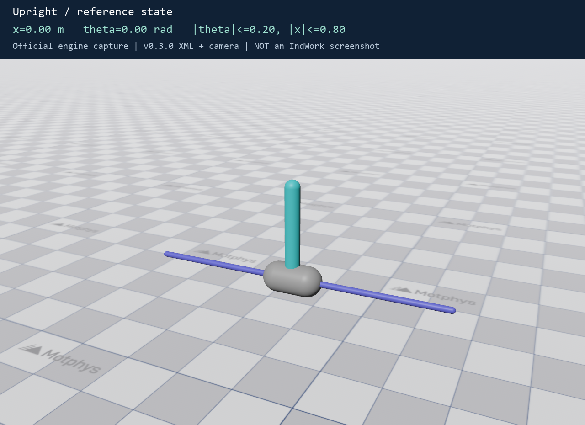
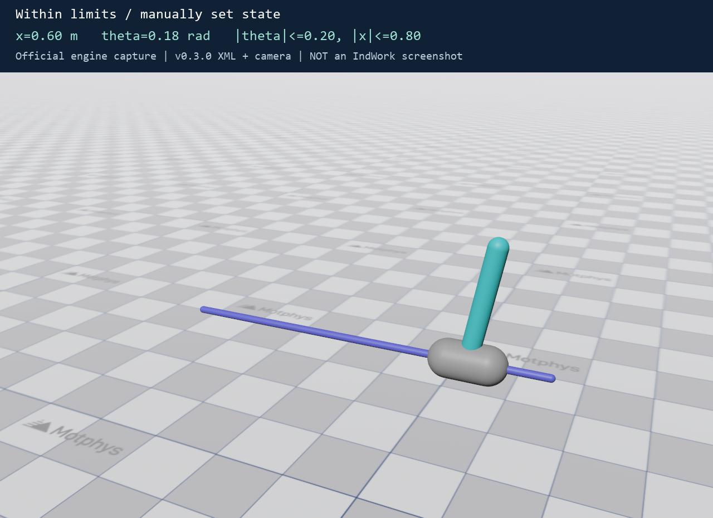
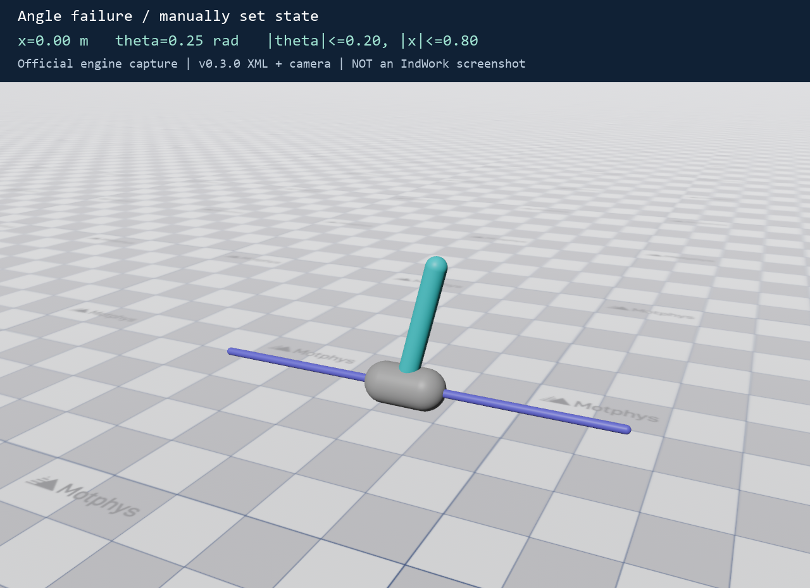

# Week 3：CartPole 环境分析与可运行仿真

**在巧工中拉取本仓库后，运行入口是 `week3/code/run_cartpole.py`。** 本目录独立提供需要的 CartPole 源码和真实地面纹理，不需要下载完整官方仓库，也不需要第二周的训练权重。

- [提交文档：CartPole分析作业.pdf](CartPole分析作业.pdf)
- [按题号作答：answer.md](answer.md)
- [仿真运行入口](code/run_cartpole.py)
- [运行结果：2000 步平衡演示](evidence/balance_run.json)
- [运行结果：原任务规则核验](evidence/verification.json)

## 当前 Linux 桌面运行

已在本机建立独立的 `.venv`（Python 3.10.19、MotrixSim 0.7.0），可以双击桌面的 **第三周 CartPole** 启动仿真，或在 `week3` 目录执行：

```bash
./run_cartpole.sh
./run_cartpole.sh --headless --steps 2000
```

本机实际完成 2000 步平衡演示，两个回合均达到 1000 步时间截断，失败次数为 0；带窗口运行和规则核验也已通过。复现命令、环境版本、日志和真实桌面截图见 [本机复现记录](evidence/local_run/README.md)。平衡控制使用现有 LQR 工程基线。

## 拉取后怎么运行

本目录使用 **Python 3.10、MotrixSim 0.7.0**。建议使用独立环境，避免覆盖巧工中其他项目的依赖。

在仓库根目录进入 `week3`。有 `uv` 时，运行：

```powershell
cd week3
uv run python code/run_cartpole.py
```

这会打开 CartPole 仿真窗口，演示 20 秒的小车平衡控制。默认种子是 42；关闭窗口或按 Ctrl+C 可提前结束。`uv` 会根据本目录 `pyproject.toml` 准备 Python 3.10 环境。首次运行需要联网下载依赖。

**已安装 Python 3.10、但没有 uv 时（Windows）：**

```powershell
cd week3
py -3.10 -m venv .venv
.\.venv\Scripts\python.exe -m pip install -r requirements.txt
.\.venv\Scripts\python.exe code/run_cartpole.py
```

Linux 将环境创建命令改为 `python3.10 -m venv .venv`，后续 Python 路径改为 `.venv/bin/python`。显示仿真窗口需要可用的图形桌面和显卡驱动；只有终端的环境先运行下面的无窗口核验。

## 可选任务

以下命令均在 `week3` 目录执行：

```powershell
# 默认：平衡演示（LQR 工程控制器，不是强化学习训练）
uv run python code/run_cartpole.py --mode balance --steps 2000

# 随机动作：观察失衡、奖励、自动重置
uv run python code/run_cartpole.py --mode random --steps 1000

# 不开窗口，检查依赖和完整回合
uv run python code/run_cartpole.py --headless --steps 2000 --report evidence/my_balance_run.json

# 核对观测顺序、失败边界、1000 步超时、初始噪声、执行器限幅
uv run python code/verify_cartpole.py

# 重新生成三张官方引擎效果图（原始相机图也一并保存）
uv run python code/capture_cartpole.py

# 将新图片保存到独立目录（支持 Windows、Linux、macOS 字体）
uv run python code/capture_cartpole.py --output evidence/local_run/capture
```

如果使用手动创建的环境，把 `uv run python` 替换成 `.\.venv\Scripts\python.exe` 或 `.venv/bin/python`。

`balance` 模式根据实际模型的一步动力学计算局部线性 LQR 控制器，属于方便看效果的工程基线；本周题目不要求训练，因此没有伪造 RL 模型或训练曲线。固定 seed=42 的本次结果是两个 1000 步回合均时间截断，失败回合数为 0。该结果只覆盖本次初始状态，不代表对任意扰动都有保证。

## 效果图

下图是 **官方 MotrixSim 引擎的相机渲染**。为了对照题目阈值，手动设置了状态并添加取景相机；它们不是巧工界面截图，也不是训练过程截图。







## 目录说明

| 路径 | 内容 |
| --- | --- |
| `CartPole分析作业.pdf` | 按题号完成的作业，含流程图、八要素表、源码图片和效果图。 |
| `answer.md` | 同一份作答的 Markdown 版本。 |
| `code/` | 仿真入口、规则核验、相机采图、报告生成和源码提取脚本。 |
| `source/` | 官方 v0.3.0 的最小源码快照、纹理、Apache-2.0 许可证和 NOTICE。 |
| `evidence/` | 原始日志、JSON 检查结果、源码导出图、流程图、三组引擎相机图。 |

## 版本与复现说明

依据官方 [MotrixLab v0.3.0](https://github.com/Motphys/MotrixLab/tree/e1421d10559c825e72bab0f3cbb517c333d67e16)，提交 `e1421d10559c825e72bab0f3cbb517c333d67e16`。源码快照的 SHA-256 清单在 `evidence/source_manifest.json`；地面纹理也经过该提交 Git LFS 对象哈希验证。

`code/runtime.py` 仅建立包命名空间并加载 CartPole，避免导入无关机器人；环境类、注册表、基类、配置和渲染器使用保留版权声明的原始源码，未修改任务逻辑。原始源码图片从这些文件导出，保留版本、路径和原始行号，明确标为源码导出图。

需要重新生成 PDF 时，在另外的文档环境安装 `reportlab` 和 `pillow`，在 Windows 上运行 `python code/build_report.py`；该排版脚本使用系统中文字体。仿真本身不依赖 ReportLab。

原始作业提交未提供巧工窗口截图。本机现已运行 MotrixRender 窗口并保存 [真实桌面截图](evidence/local_run/desktop_cartpole.png)；它与上面的引擎相机采图分别保存。
