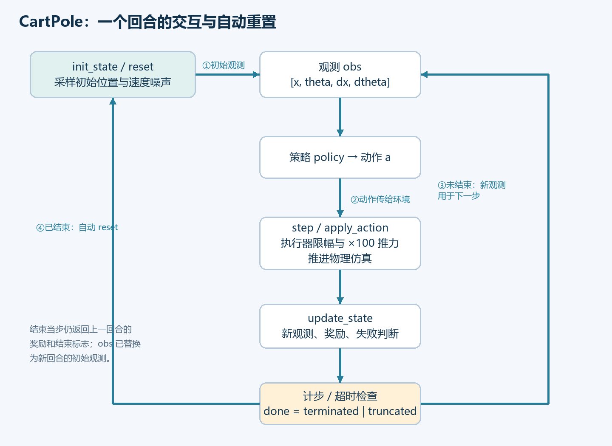
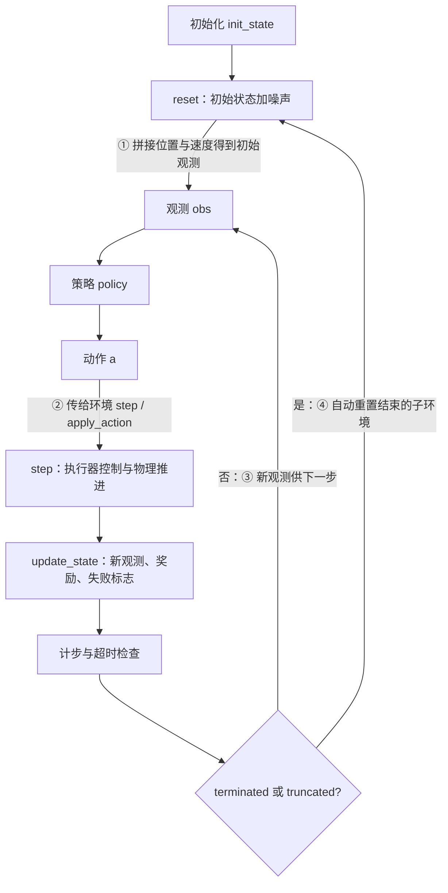
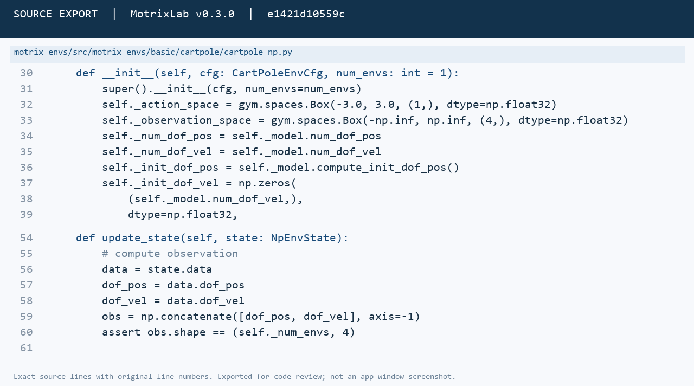
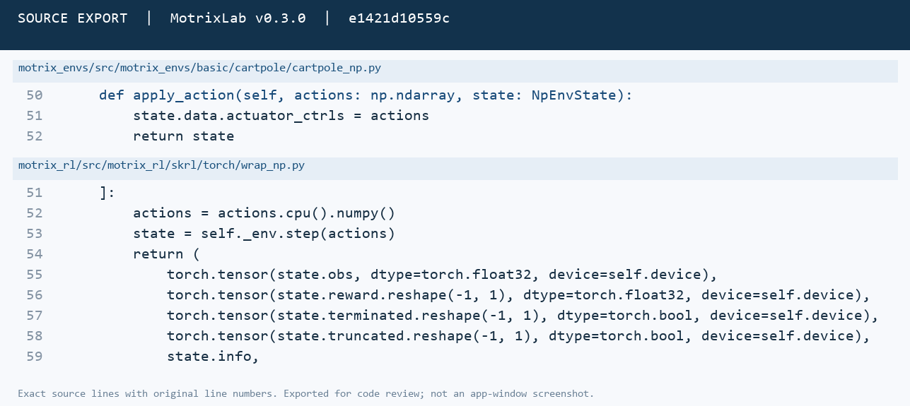
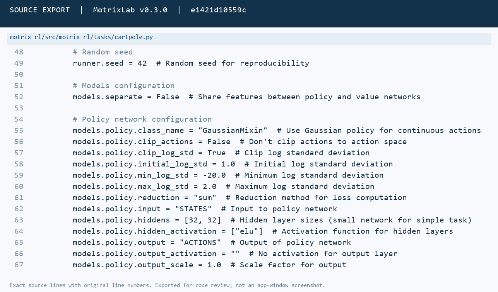
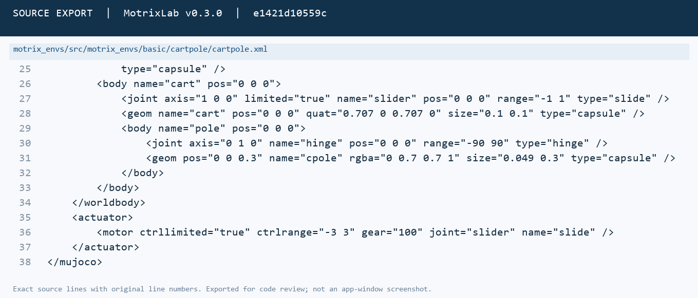
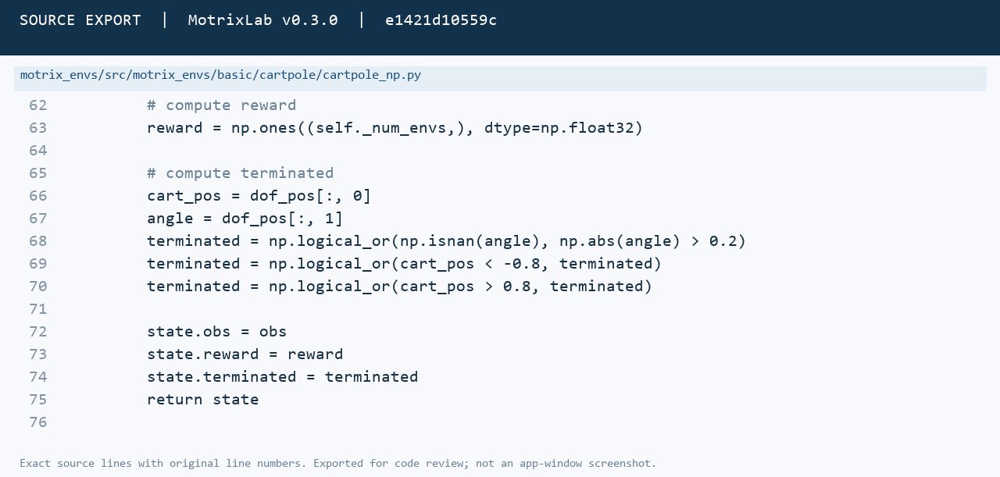
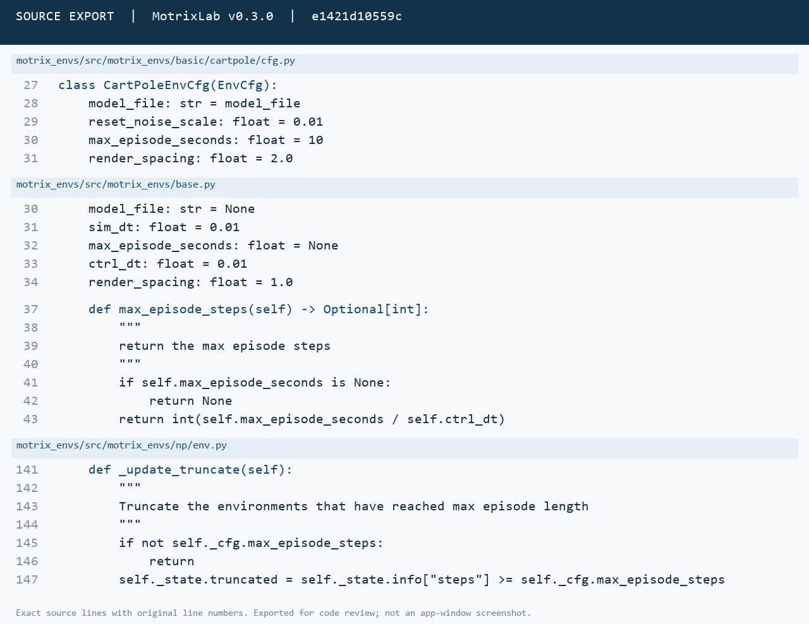
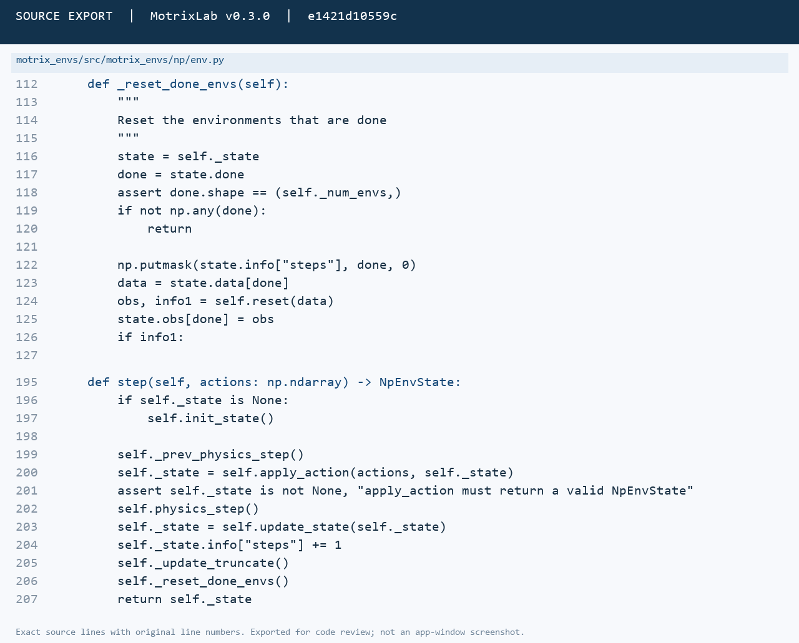
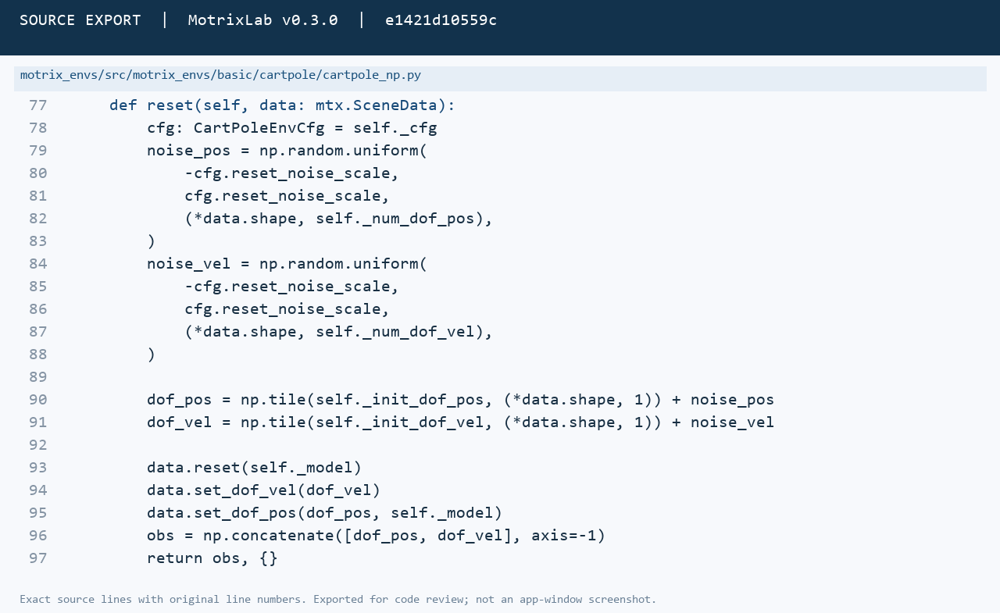

# 第三周：CartPole 环境分析

依据 **MotrixLab v0.3.0**，提交 `e1421d10559c825e72bab0f3cbb517c333d67e16`。以实际仓库为准。本周不要求训练，本次没有训练。可直接提交的排版文档为 [CartPole分析作业.pdf](CartPole分析作业.pdf)。

源码图片来自该提交的真实文件，保留文件路径、原始行号和版本号；它们是源码排版导出图，**不是巧工软件窗口截图**。补充仿真图属于官方 MotrixSim 引擎的程序化渲染，手动设置状态用于说明阈值。

## 一、任务与交互流程（20 分）

### 1. 一句话问答（4 分）

- **动作直接作用于哪个部件？** 作用于小车的水平滑动关节 `slider` 对应的电机执行器 `slide`，经执行器对小车施加水平推力，间接影响摆杆。
- **希望保持什么状态？** 希望摆杆接近竖直向上，并让小车始终留在允许的位置区间内，通过左右移动小车尽可能长时间保持平衡。

来源：`motrix_envs/src/motrix_envs/basic/cartpole/cartpole.xml` 的 `cart/slider`、`pole/hinge` 和 `actuator/motor`；`cartpole_np.py update_state()`。

### 2. 一个回合的交互流程图（12 分）

四条关系核对：

1. 初始观测：`NpEnv.init_state()` → `_reset_done_envs()` → `CartPoleEnv.reset(data)` → `concatenate([dof_pos, dof_vel])` → `state.obs`。
2. 动作去向：策略输出 → `SkrlNpWrapper.step()` → `NpEnv.step()` → `CartPoleEnv.apply_action()` → `state.data.actuator_ctrls` → 执行器 → 物理仿真。
3. 下一步：未结束时，`update_state()` 生成的新观测由包装器返回策略，用来计算下一次动作。
4. 结束后：同一次 `NpEnv.step()` 在返回前调用 `_reset_done_envs()`，对 `terminated | truncated` 为真的子环境调用 `CartPoleEnv.reset(data)`，计数归零，以重置后的观测开始下一回合。

**具体实现顺序：** `apply_action → physics_step → update_state → steps += 1 → _update_truncate → _reset_done_envs → return state`。结束当步的 reward 和结束标志仍属于上一回合，但返回的 `obs` 已被替换为新回合的初始观测；不要再无条件手动重置一次。

来源：`motrix_envs/src/motrix_envs/np/env.py` 的 `init_state()`、`step()`、`_reset_done_envs()`；`motrix_rl/src/motrix_rl/skrl/torch/wrap_np.py` 的 `reset()`、`step()`。

### 3. terminated 与 truncated（4 分）

| 标志 | 含义 | CartPole 例子 |
| --- | --- | --- |
| `terminated` | 任务内部的失败或异常终止。 | 未超时时，杆角度 `0.21 rad` 满足 `abs(angle) > 0.2`，导致失败终止。 |
| `truncated` | 达到外部时间/步数上限而截断，并不代表任务失衡。 | 小车、杆状态仍正常，但 `steps >= 1000`，即控制时长达到 `10 s`。 |

来源：`cartpole_np.py update_state()`；`np/env.py _update_truncate()`；`base.py EnvCfg.max_episode_steps`。

## 二、八要素表（40 分）

以下环境文件均在 `motrix_envs/src/motrix_envs/` 下；训练文件在 `motrix_rl/src/motrix_rl/` 下。完整源码快照位于 [source/](source/)，可核对路径及函数。

| 要素 | 答案 | 来源 |
| --- | --- | --- |
| 智能体 | ① 策略控制小车的水平运动，小车与摆杆组成受控系统。② 接收四维状态 `[x, θ, ẋ, θ̇]`，输出一维连续控制量 `a`，经电机对小车施力。 | `basic/cartpole/cartpole_np.py __init__()/apply_action()/update_state()`；`basic/cartpole/cartpole.xml actuator/motor`。 |
| 环境 | ① 主要对象是地面 `floor`、轨道 `rail`、小车 `cart`（滑动关节 `slider`）、摆杆 `pole`（转动关节 `hinge`），另有重力和灯光。② `CartPoleEnvCfg.model_file` 指向 `cartpole.xml`；`NpEnv.__init__()` 中用 `mtx.load_model(cfg.model_file)` 加载，随后用 `cfg.sim_dt` 设置仿真步长。 | `basic/cartpole/cartpole.xml worldbody/option`；`basic/cartpole/cfg.py CartPoleEnvCfg`；`np/env.py NpEnv.__init__()`。 |
| 观测 | ① 四维，空间定义为 `Box(-inf, inf, (4,), float32)`。② 顺序：小车位置 `x`（m）、杆相对竖直向上的角度 `θ`（rad）、小车速度 `ẋ`（m/s）、杆角速度 `θ̇`（rad/s），即先两个位置自由度，再两个速度自由度。 | `basic/cartpole/cartpole_np.py __init__()/update_state()/reset()`；`basic/cartpole/cartpole.xml slider/hinge`。 |
| 动作 | ① 一维连续动作，声明范围 `[-3, 3]`。② 输入赋给 `actuator_ctrls`，由 `slide` 电机驱动小车 `slider`。XML 实际限幅为 `[-3,3]`，`gear=100`，故电机施加的水平推力为 `F = 100 × clip(a,-3,3) N`，有效范围 `[-300,300] N`。动作数值本身不能误写成最终 ±3 N。 | `basic/cartpole/cartpole_np.py __init__()/apply_action()`；`basic/cartpole/cartpole.xml actuator/motor`；训练侧 `tasks/cartpole.py CartPoleSkrlPpo.__post_init__()`。 |
| 奖励 | ① 每一步 `reward = np.ones((num_envs,), dtype=np.float32)`，每个子环境得 `+1`，**失败当步也得 +1**。② 越晚越界就能累积更多步的奖励，因此鼓励长时间平衡、避免出界；没有显式角度误差、位置居中或能耗惩罚。 | `basic/cartpole/cartpole_np.py update_state()`。 |
| 初始状态 | ① 模型初始位置和角度均为 0，分别加 `Uniform(-0.01,0.01)` 噪声，故 `x ∈ [-0.01,0.01) m`、`θ ∈ [-0.01,0.01) rad`。② 初始两个速度基值也为 0，各加相同范围的独立采样噪声，分别是 m/s 和 rad/s。均匀分布通常不含右端点，浮点实现有舍入细节。 | `basic/cartpole/cartpole_np.py __init__()/reset()`；`basic/cartpole/cfg.py CartPoleEnvCfg.reset_noise_scale`；`basic/cartpole/cartpole.xml`。 |
| 终止条件 | ① `isnan(θ)`、`abs(θ)>0.2 rad`、`x<-0.8 m` 或 `x>0.8 m`，任一成立即失败。恰好边界不因对应严格不等式触发；没有对所有状态统一作 `isfinite` 检查。② 默认 `10 s`；`ctrl_dt=0.01 s`，`int(10/0.01)=1000` 个控制步，`steps>=1000` 截断。`sim_dt=0.01 s`，每控制步含 `round(ctrl_dt/sim_dt)=1` 个物理子步。 | `basic/cartpole/cartpole_np.py update_state()`；`basic/cartpole/cfg.py CartPoleEnvCfg`；`base.py EnvCfg.max_episode_steps/sim_substeps`；`np/env.py _update_truncate()`。 |
| 域随机化 | ① **已实现初始状态随机化**：两个位置自由度、两个速度自由度在零基值上各加 `Uniform(-0.01,0.01)` 噪声。**未实现物理参数域随机化**：质量、长度、摩擦、重力等在本任务中没有随机采样逻辑。② 每次调用 `CartPoleEnv.reset(data)` 都重新采样，包括首次初始化和回合结束后的自动重置；不在普通每步重新采样。 | 查找 `basic/cartpole/cartpole_np.py __init__()/reset()/apply_action()/update_state()`；`basic/cartpole/cfg.py`；`basic/cartpole/cartpole.xml`；`np/env.py _reset_done_envs()`。 |

## 三、代码阅读（40 分）

### 1. 观测（10 分）

实际顺序与维度：

| 分量 | 对应代码 | 物理含义 | 单位 | 维度 |
| --- | --- | --- | --- | --- |
| 1 | `dof_pos[:,0]` | 小车沿 x 轴的位置 | m | 1 |
| 2 | `dof_pos[:,1]` | 杆绕 y 轴相对直立的角度 | rad | 1 |
| 3 | `dof_vel[:,0]` | 小车沿 x 轴的速度 | m/s | 1 |
| 4 | `dof_vel[:,1]` | 杆角速度 | rad/s | 1 |

`1 + 1 + 1 + 1 = 4`，也可写为位置 2 维 + 速度 2 维 = 4 维。与 `Box(-np.inf, np.inf, (4,), dtype=np.float32)` 一致；并行批次的实际形状为 `(num_envs,4)`，不是把 `num_envs` 计入单个环境的观测维度。

来源：`motrix_envs/src/motrix_envs/basic/cartpole/cartpole_np.py __init__()/update_state()`；`cartpole.xml slider/hinge`。

### 2. 动作（10 分）

控制部件：`slide` 电机 → 小车 `slider` 滑动关节；最终物理量为沿滑动轴（x 方向）的推力，不是位置指令，也不是直接对摆杆施加转矩。

**完整路径（以本版本 CartPole SKRL/PyTorch 配置为例）：**

策略高斯动作 `a`（`clip_actions=False`，**无策略动作裁剪**；无额外动作缩放）
→ `SkrlNpWrapper.step()`（`actions.cpu().numpy()`，只转换设备和数据类型，**无裁剪、无缩放**）
→ `NpEnv.step(actions)`（传递给 `apply_action`，**无裁剪、无缩放**）
→ `CartPoleEnv.apply_action()`（`state.data.actuator_ctrls = actions`，**无裁剪、无缩放**）
→ XML `motor name="slide" joint="slider"`（`ctrllimited="true"`，按 `ctrlrange="-3 3"` 限幅）
→ `gear="100"`（执行器传动缩放 ×100）
→ 小车水平推力 `F=100×clip(a,-3,3) N`。

三处检查：

1. `apply_action()`：直接赋值，没有 `np.clip` 或乘比例系数。
2. XML：有明确的执行器限幅和传动增益；`a=2` 时 `F=200 N`，`a=5` 时先限为 3，再得到 `300 N`。
3. `motrix_rl/src/motrix_rl/tasks/cartpole.py CartPoleSkrlPpo.__post_init__()`：`models.policy.clip_actions=False`；`output_scale=1.0`、输出激活为空，配置没有额外增益或 tanh 压缩；`ppo.py Trainer._make_model()` 中实际线性 `mean_layer` 直接输出均值，并把 `clip_actions` 交给 `GaussianMixin`。这是该任务实际配置，不能用模板 YAML 中的 `clip_actions: True` 替代。

注意：`Box(-3,3)` 描述接口空间，本身不执行裁剪；`clip_log_std=True` 限制的是高斯分布的对数标准差，不是对动作值的裁剪。XML 的执行器限幅仍然有效。

来源：上述三个文件，以及 `motrix_rl/src/motrix_rl/skrl/torch/wrap_np.py SkrlNpWrapper.step()`、`motrix_envs/src/motrix_envs/np/env.py NpEnv.step()`、`motrix_rl/src/motrix_rl/skrl/torch/train/ppo.py Trainer._make_model()`。

### 3. 奖励（10 分）

- 持续 20 步：`G = Σ(t=1..20) 1 = 20`。
- 持续 80 步：`G = Σ(t=1..80) 1 = 80`。

只要没有提前结束，继续一步就多得 1。杆角度或小车位置越界会使回合提前结束，可累积的奖励也更少，因此累计回报鼓励策略让杆保持直立、小车留在允许范围内，尽量延长回合，直到 1000 步上限。

**以代码为准：** `reward=np.ones(...)` 在失败判断之前无条件计算，失败当步仍得 `+1`，没有失败扣分；奖励没有直接强制小车居中，也没有对角度误差或动作大小加惩罚。

来源：`motrix_envs/src/motrix_envs/basic/cartpole/cartpole_np.py update_state()`。

### 4. 终止与截断（10 分）

| 情形 | 分类 | 代码判据 |
| --- | --- | --- |
| ① 杆角度越界，其余正常且未超时 | 失败终止 `terminated=True` | `np.abs(angle)>0.2`，单位 rad，约 11.46°；例如 0.21 rad。 |
| ② 小车位置越界，其余正常且未超时 | 失败终止 `terminated=True` | `cart_pos < -0.8` 或 `cart_pos > 0.8`，单位 m；例如 0.81 m。 |
| ③ 状态正常但超时 | 时间截断 `truncated=True` | `steps >= max_episode_steps`；`int(10 s / 0.01 s)=1000` 步。 |

情形①②按题设均为 `truncated=False`；情形③为 `terminated=False`。代码还专门检查 `np.isnan(angle)`；没有为所有其他非有限状态统一实现异常检查。

失败判定见上一张源码图；超时和重置见下图。

由 **基类环境 `NpEnv`** 负责重置，而不是要求策略在每次结束后自行调用。`NpEnv.step()` 在完成失败和超时计算后，调用 `NpEnv._reset_done_envs()`；该函数用 `state.done = terminated | truncated` 选出结束的子环境，清零 `info["steps"]`，调用子类的 **`CartPoleEnv.reset(data)`**，并替换这些子环境的观测。

`CartPoleEnv.reset()` 在新回合重新采样位置与速度噪声：

来源：`motrix_envs/src/motrix_envs/np/env.py NpEnvState.done/NpEnv.step()/_update_truncate()/_reset_done_envs()`；`basic/cartpole/cartpole_np.py reset()`；`base.py EnvCfg.max_episode_steps`。

## 补充：运行核验与证据

核验脚本为 [code/verify_cartpole.py](code/verify_cartpole.py)，结果为 [evidence/verification.json](evidence/verification.json)。它对官方 v0.3.0 原始环境进行运行检查，不训练模型、不加载第二周权重：

1. 观测顺序、动作空间和控制时钟。
2. 角度及位置严格不等式边界、角度 NaN 分支。
3. 零噪声精确直立状态下，以零动作走完 1000 步，检查 10 秒截断；**这只是计时与重置核验，不是学习效果或鲁棒平衡能力的证明**。
4. 强制失败后返回的奖励、结束标志、计数归零和初始观测。
5. 1024 个重置样本的四维初始状态范围。
6. 正负超范围动作与边界动作的一步动力学对比，检查 XML 执行器限幅。

仿真入口为 [code/run_cartpole.py](code/run_cartpole.py)，拉取后可直接使用随附的最小官方源码快照，无需另行克隆完整 MotrixLab。额外的 `balance` 模式使用根据实际动力学构建的局部线性 LQR 工程控制器；seed=42 下实际运行 2000 步，两个回合均达到 1000 步时间截断，失败回合为 0，详见 [evidence/balance_run.json](evidence/balance_run.json)。这是工程演示，不是强化学习训练结果。

实操限制：本会话未提供可用的巧工桌面控制通道，因此未在巧工中进行点击操作，也未提供巧工窗口截图。作业正文是基于指定版本的源码分析；源码图片、运行核验和引擎渲染均分别标明来源。
