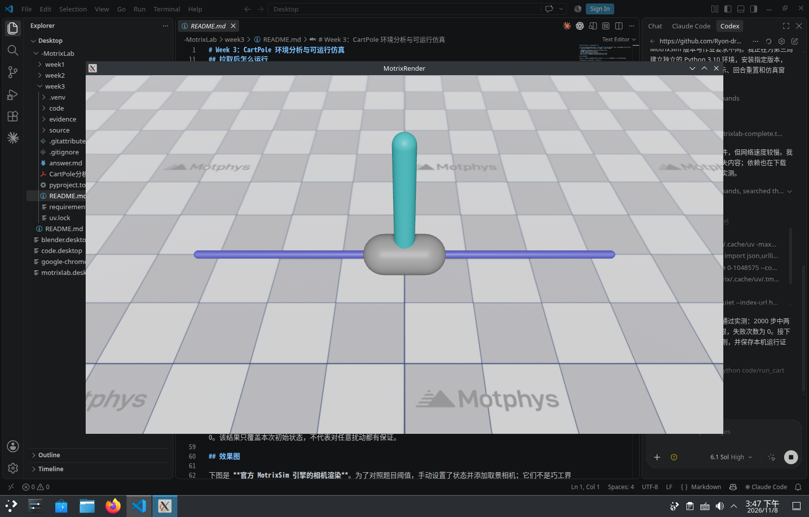

# Linux 本机复现记录

复现日期：2026-11-08（Asia/Shanghai）。仓库原始提交：`c2834efaeebd1a038a2766e1847dcaa3f9cc8738`。从 GitHub 获取代码并校验了全部 179 个文件的 Git 对象哈希，保留原提交和浅克隆历史；官方最小源码快照的 13 个 SHA-256 校验也全部通过。

独立环境：Python 3.10.19、MotrixSim 0.7.0、NumPy 2.2.6、Gymnasium 1.1.1、Pillow 12.3.0；操作系统 Linux，GPU NVIDIA GeForce RTX 5090。

在 `week3` 目录执行：

```bash
.venv/bin/python code/run_cartpole.py --headless --steps 2000 --report evidence/local_run/balance_run.json
.venv/bin/python code/run_cartpole.py --steps 2000 --report evidence/local_run/viewer_run.json
.venv/bin/python code/verify_cartpole.py
.venv/bin/python code/run_cartpole.py --headless --mode random --steps 1000 --report evidence/local_run/random_run.json
.venv/bin/python code/capture_cartpole.py --output evidence/local_run/capture
```

- [无窗口平衡结果](balance_run.json)：2000 步，2 个时间截断回合，0 个失败回合。
- [带窗口平衡结果](viewer_run.json)：2000 步，2 个时间截断回合，0 个失败回合；[日志](viewer.log)。
- [规则核验](verification.json)：全部通过；[日志](verification.log)。核验覆盖观测顺序、动作空间、严格失败边界、NaN 角度、1000 步超时、失败奖励、自动重置、1024 个初始样本及正负执行器限幅。
- [随机动作结果](random_run.json)：用于观察失败和自动重置；[日志](random_run.log)。
- [引擎相机采图](capture/capture_manifest.json)：直立、接近阈值、角度失败三组状态；[日志](capture.log)。状态为手动设置。

以下为本机运行时的真实桌面截图，保留 VS Code 和 MotrixRender 窗口；不是相机导出图。未进行强化学习训练，平衡演示使用仓库已有的 LQR 控制器。


