# 第四周：强化学习 Demo、能量奖励对照实验与 dm-reacher 分析

依据：MotrixLab **v0.3.0**，提交 `e1421d10559c825e72bab0f3cbb517c333d67e16`。课件、注释或文档与实现不一致时，以下均以该提交的代码及 XML 为准。运行日期：2026-11-10（Asia/Shanghai）。

提交人：Ryon-droid。本文与 `第四周作业.pdf` 内容一致；视频随文档保存在 `videos/`，在线入口为 https://github.com/Ryon-droid/-MotrixLab/tree/main/week4/videos 。PDF 内的视频链接也可直接访问 GitHub 文件页并下载播放。

运行环境：Linux x86_64，Python 3.10.19，MotrixSim 0.7.0，NumPy 2.2.6，Gymnasium 1.1.1，SKRL 1.4.3，PyTorch 2.7.0+cu128（本次明确用 CPU），TensorBoard 2.20.0。保留官方任务逻辑、模型和 PPO 实现，使用 `code/runtime.py` 只加载本周所需模块；B 组单独载入仅改一行的奖励文件。

**证据说明：**代码图和结束日志图是在浏览器内显示真实文件文本后截取的图片，保留文件名、行号；TensorBoard 图是真实本地仪表盘截图。视频由加载已训练 PPO 权重产生的真实完整回合轨迹，经官方 MotrixSim 引擎相机渲染，不是绘制的示意动画。相机仅增加取景设置，物理模型不变。dm-reacher 另有真实桌面窗口截图和带标注的引擎相机截图。

## 一、三个 Demo 的运行与比较（35 分）

### 1. 训练并回放 CartPole、Pendulum、Acrobot

以下命令均在 `week4/` 目录执行。`--steps` 的单位是**每环境的控制步/批量步**，总环境转移数等于 `steps × num_envs`。为适应本次实验，统一将并行数从官方默认 2048 改为 128，其余任务 PPO 超参数沿用官方值；三项训练均从头开始。Pendulum 的 8192 步超过官方默认 5000；Acrobot 的 8192 步少于官方默认 29000，明确作为有限预算实验，不声称收敛。

`code/train.py` 调用官方 `Trainer` 的网络和 PPO 构造器、官方 wrapper 及 SKRL SequentialTrainer；有限回放入口 `code/evaluate.py` 采用官方 `play()` 同样的 `mean_actions` 确定性动作，并在结束时停止。由于官方 `NpEnv.step()` 会自动重置，入口在原 `update_state()` 返回后、自动重置前记录物理状态，防止末帧混入下一回合。

#### 1.1 CartPole

训练命令：

```bash
CUDA_VISIBLE_DEVICES='' .venv/bin/python -u code/train.py --env cartpole --num-envs 128 --steps 4096 --seed 42
```

实际完成 **4096 批量步、524288 条环境转移、128 轮 PPO 更新**。加载模型：`week4/runs/cartpole/final_agent.pt`，使用最后一次更新后的权重，未根据回放结果挑选 checkpoint。

回放及视频生成命令：

```bash
CUDA_VISIBLE_DEVICES='' .venv/bin/python code/evaluate.py --env cartpole --seeds 0 --policy runs/cartpole/final_agent.pt
.venv/bin/python code/render_replays.py --task cartpole
```


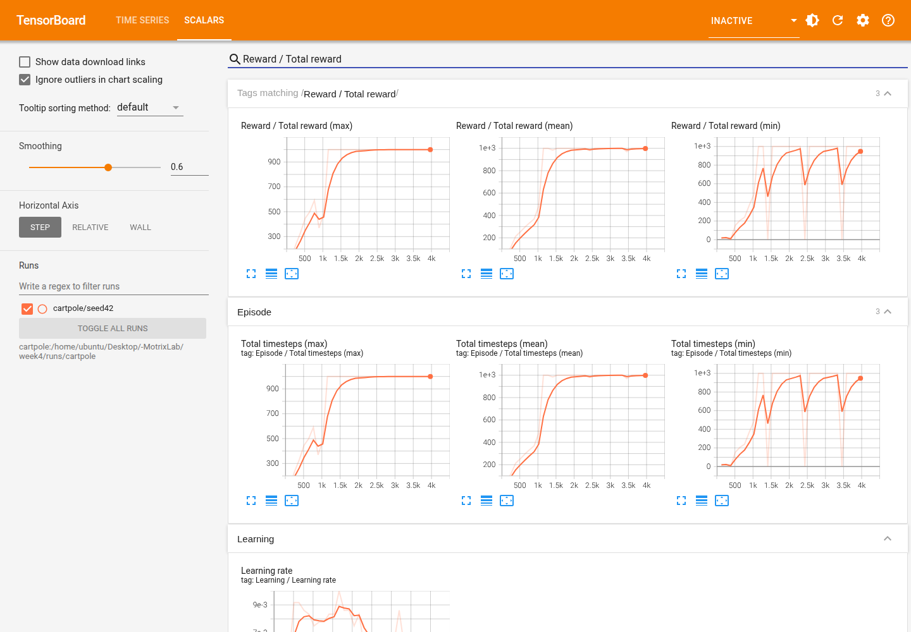

完整回合视频：[CartPole / seed 0](https://github.com/Ryon-droid/-MotrixLab/blob/main/week4/videos/cartpole_seed0.mp4)。本次回合持续 1000 控制步，即 10 s，回报 1000，`terminated=False, truncated=True`。原始状态、动作、结束标志见 `evidence/replay/cartpole/`。

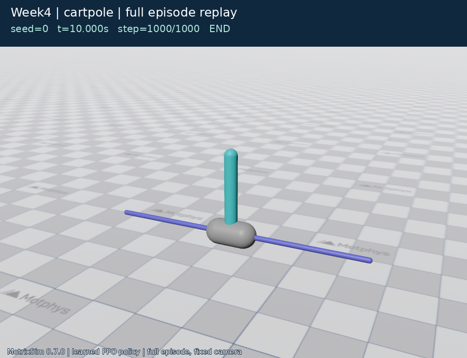

#### 1.2 Pendulum

本项沿用第二题 **A 组默认奖励**的训练，不重复训练另一份模型。命令：

```bash
CUDA_VISIBLE_DEVICES='' .venv/bin/python -u code/train.py --env pendulum --group A --num-envs 128 --steps 8192 --seed 42
CUDA_VISIBLE_DEVICES='' .venv/bin/python code/evaluate.py --env pendulum --group A --seeds 0 1 2 --policy runs/pendulum_A/final_agent.pt
.venv/bin/python code/render_replays.py --task pendulum_A
```

实际完成 **8192 批量步、1048576 条环境转移、256 轮 PPO 更新**。加载模型：`week4/runs/pendulum_A/final_agent.pt`。


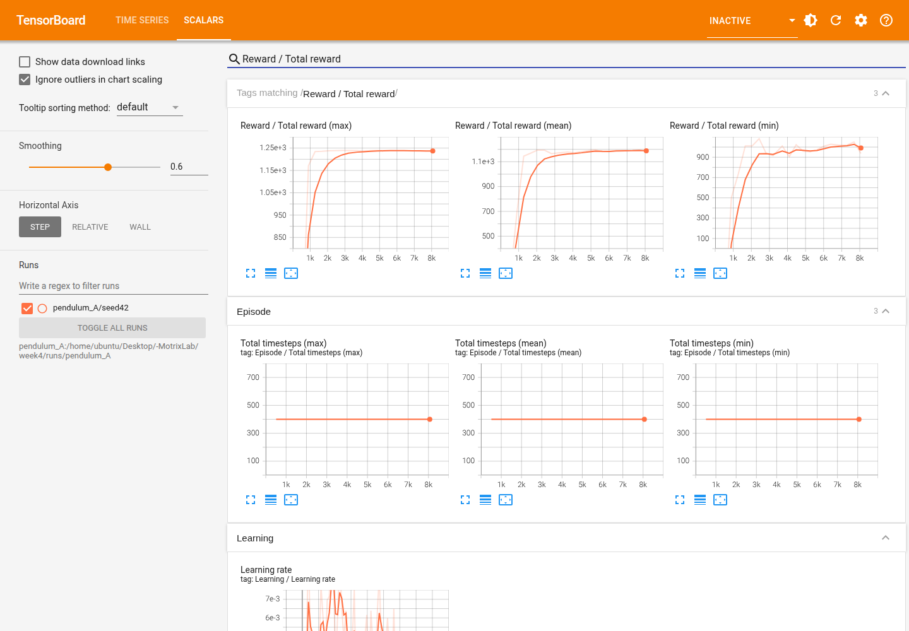

完整回合视频：[Pendulum A / seed 0](https://github.com/Ryon-droid/-MotrixLab/blob/main/week4/videos/pendulum_A_seed0.mp4)。该回合 400 控制步、10 s，达到时间上限，结束标志为 `False, True`。三个种子的完整记录见第二题。

#### 1.3 Acrobot

```bash
CUDA_VISIBLE_DEVICES='' .venv/bin/python -u code/train.py --env acrobot --num-envs 128 --steps 8192 --seed 42
CUDA_VISIBLE_DEVICES='' .venv/bin/python code/evaluate.py --env acrobot --seeds 0 --policy runs/acrobot/final_agent.pt
.venv/bin/python code/render_replays.py --task acrobot
```

实际完成 **8192 批量步、1048576 条环境转移、128 轮 PPO 更新**；该任务 rollouts=64。加载模型：`week4/runs/acrobot/final_agent.pt`。

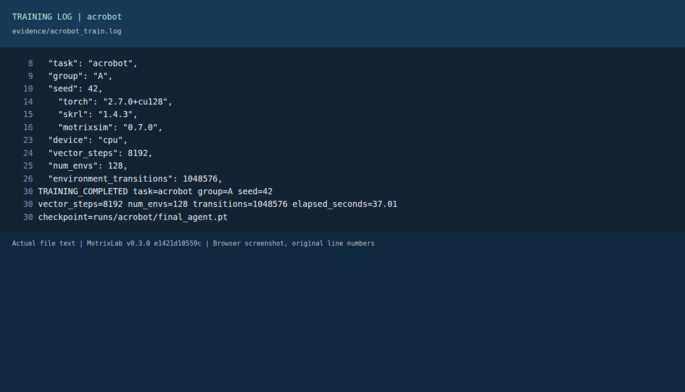

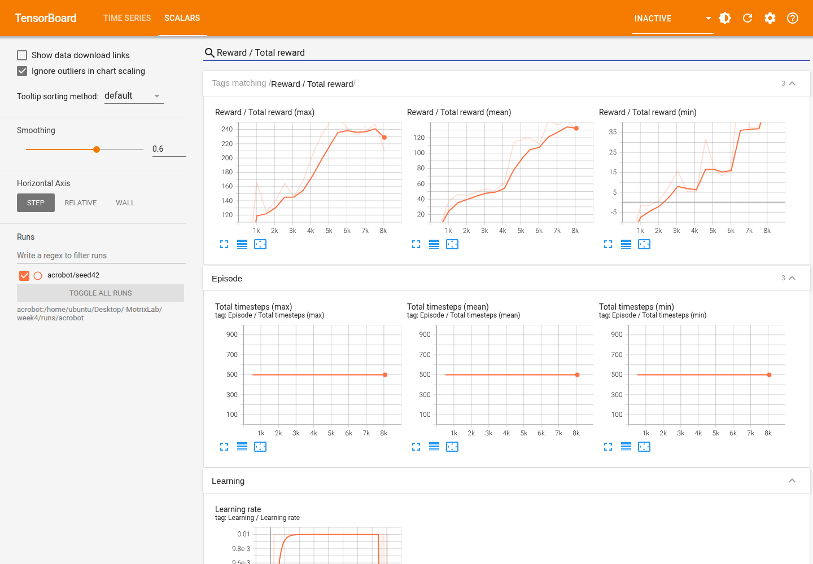

完整回合视频：[Acrobot / seed 0](https://github.com/Ryon-droid/-MotrixLab/blob/main/week4/videos/acrobot_seed0.mp4)。本次回合 500 控制步、10 s，回报约 175.681，超时时 `terminated=True, truncated=True`。有限预算训练完成了可加载、可执行、可回放的闭环，但视频中的摆动不能证明已经学会稳定到达目标。

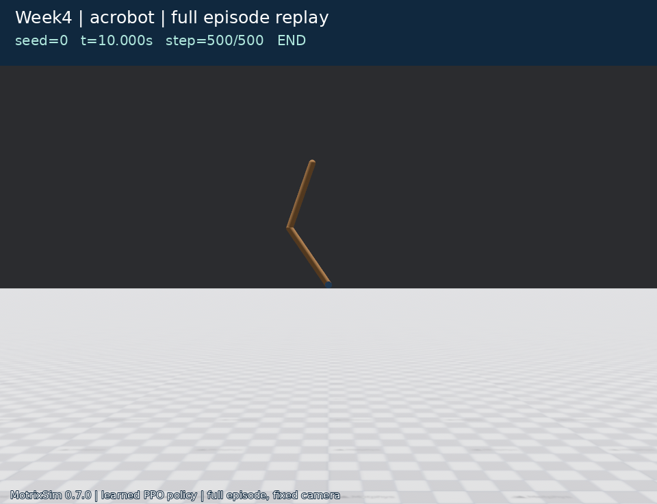

三项训练曲线均来自保留的原始 `runs/*/seed42/events.out.tfevents.*`。横轴 STEP 是批量步，乘 128 才是环境转移数；图中平滑线是 TensorBoard 默认 smoothing=0.6，底层标量另存为 `evidence/scalars.csv`。不同任务的奖励定义不同，不能直接比较纵轴高低来比较任务表现。

### 2. 八要素对比表（16 分）

每格的①②分别回答第三周同一要素的两个问题。表内环境路径省略共同前缀 `motrix_envs/src/motrix_envs/`；三种任务名分别简写 C、P、A，指 `basic/cartpole/`、`basic/pendulum/`、`basic/acrobot/`。源码保存在 `source/`，路径与官方一致。

| 要素 | CartPole | Pendulum | Acrobot | 比较与来源 |
| --- | --- | --- | --- | --- |
| 智能体 | ①控制小车与被动摆杆系统。②接收4维状态，输出1维连续动作，经小车电机施力。 | ①控制一个转动关节的摆杆。②接收3维观测，输出1维连续动作，经铰链电机施加转矩。 | ①控制双连杆欠驱动系统。②接收6维观测，输出1维连续动作，仅直接控制肘关节。 | 三者均为连续控制；Acrobot 的关节数多于驱动数。来源：C/P/A 的 `*_np.py __init__()/apply_action()` 和 XML actuator。 |
| 环境 | ①地面、轨道、小车 slider、摆杆 hinge、重力。②`CartPoleEnvCfg.model_file` 指向 cartpole.xml，由 NpEnv 加载。 | ①地面、支点、pole、末端球形质量、hinge。②PendulumEnvCfg 指向 pendulum.xml，重力下绕 y 轴转动。 | ①支点、upper_arm、lower_arm、shoulder、elbow、tip 和 z=4 m 的目标。②AcrobotEnvCfg 指向 acrobot.xml。 | 均以 XML 定义物理模型；一个滑动加转动、一个转动、两个转动，结构不同。来源：C/P/A `cfg.py`、XML worldbody；`np/env.py __init__()`。 |
| 观测 | ①4维 Box。②顺序 `[x,θ,dx,dθ]`，先位置再速度，直接输入杆角度。 | ①3维 Box。②`[cosθ,sinθ,ω]`，用两项表示周期角度。 | ①6维 Box。②`[cos q1, cos(q1+q2), sin q1, sin(q1+q2), dq1, dq2]`；第二根杆使用累计角。 | P/A 用三角编码，C 直接用角度；Acrobot 不是 `[cos q1,sin q1,cos q2,sin q2,...]`。来源：C/P `update_state()/reset()`；A `_get_obs()`。 |
| 动作 | ①1维，空间 [-3,3]。②直接写控制量；XML slide 的 gear=100、限幅[-3,3]，水平力最终为 ±300 N。 | ①1维，空间[-1,1]。②先裁剪再映射到执行器范围[-1,1]，XML torque 驱动 hinge、gear=5，转矩最终为 ±5 N·m。 | ①1维，空间[-1,1]。②裁剪后驱动 elbow，gear=30，最终转矩 ±30 N·m；shoulder 无电机。 | 三者动作维度相同，但作用对象、增益与欠驱动性不同。来源：各 `__init__()/apply_action()` 与 XML actuator；P 读取 actuator_ctrl_limits。 |
| 奖励 | ①每步+1，包括失败当步。②鼓励在边界内持续存活，没有单独的角度/动作惩罚。 | ①`3u+e−0.2ω²−0.001c²−0.001Δc²`，u=(1+cosθ)/2，e 为能量 tolerance。②鼓励近直立，同时平衡能量、转速与控制平滑性。 | ①`I(d≤0.2)+0.1I(d<0.2)+0.3(1−clip(d/2,0,1))−0.01max(mean(abs(dq))−2,0)`。②靠近末端目标、进入半径0.2 m范围，同时惩罚较大速度。 | C 是存活奖励，P 是姿态/能量塑形，A 是到目标的距离塑形。来源：各 `update_state()`；`np/reward.py tolerance()`。 |
| 初始状态 | ①x、θ 各从零加 U(-0.01,0.01) 噪声。②两个速度也从零加同范围噪声。 | ①θ~U(-π,π)。②ω=0；cfg 未定义有效的 reset_noise_scale，getattr 默认0，不加速度噪声。 | ①q1、q2 分别独立 U(-π,π)。②两个关节速度均为0；cfg 的 reset_noise_scale=0.1 没有被 reset 使用。 | 三者每回合重新采样姿态，只有 C 默认扰动速度。来源：各 `reset()` 与 `cfg.py`；不要仅依据字段名字推断实际行为。 |
| 终止条件 | ①θ 为 NaN、abs(θ)>0.2、x<-0.8 或 x>0.8 时 terminated=True。②10 s、1000步正常超时为 False/True。 | ①只有观测出现 NaN 时 terminated=True；进入直立范围不会结束。②10 s、400步正常超时为 False/True。 | ①观测 NaN 或内部计数达到500时 terminated=True；到目标不会提前结束。②10 s、500步时基类也截断，所以 True/True。 | 超时标志不相同：A 自己把时限也写进 terminated。来源：C/P/A `update_state()`，A `_reset_done_envs()`，`np/env.py _update_truncate()/step()`，`base.py max_episode_steps`。 |
| 域随机化 | ①重置时随机位置、角度和速度；质量、长度、重力固定。②每次 reset 重采样，普通控制步不采样。 | ①重置时随机角度；质量、长度、摩擦、重力不做参数随机化。②每次 reset 重采样角度，默认不随机速度。 | ①重置时随机两个角度；目标、质量、杆长、动力学参数固定。②每次 reset 重采样；reset_noise_scale 不参与。 | 共同点是初始状态随机化，没有本任务实现的物理参数域随机化。来源：各 `reset()`、`cfg.py`、XML，及基类 `_reset_done_envs()`。 |

附件：Pendulum 观测、动作、奖励代码。

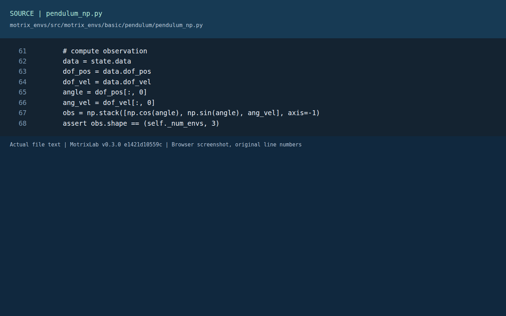

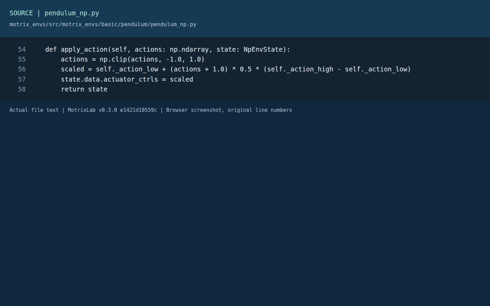

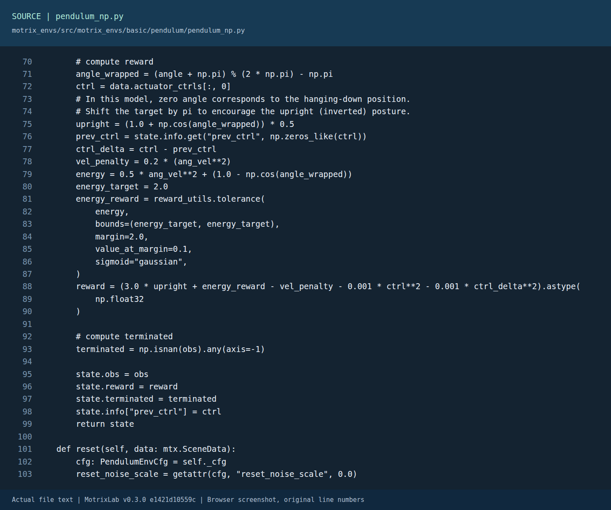

附件：Acrobot 观测、动作、奖励代码。CartPole 可对照第三周 `evidence/code_observation.png`、`code_apply_action.png`、`code_reward_termination.png`。

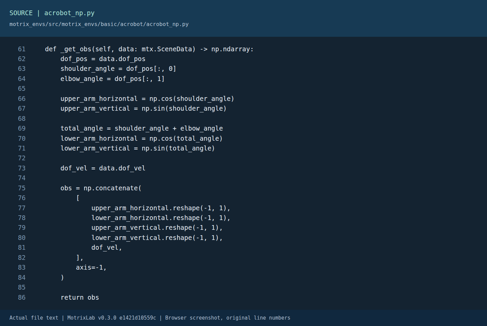

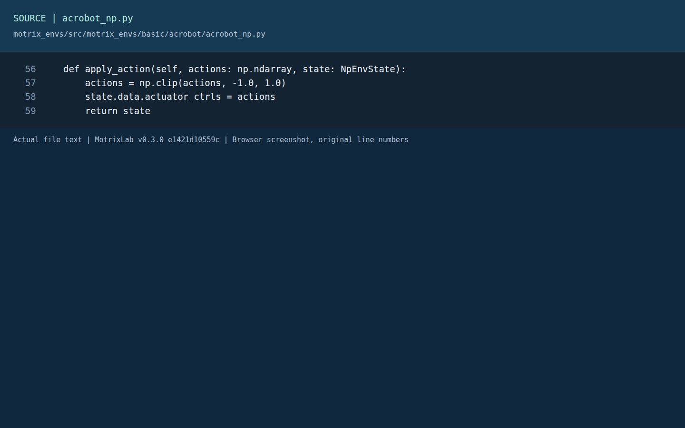

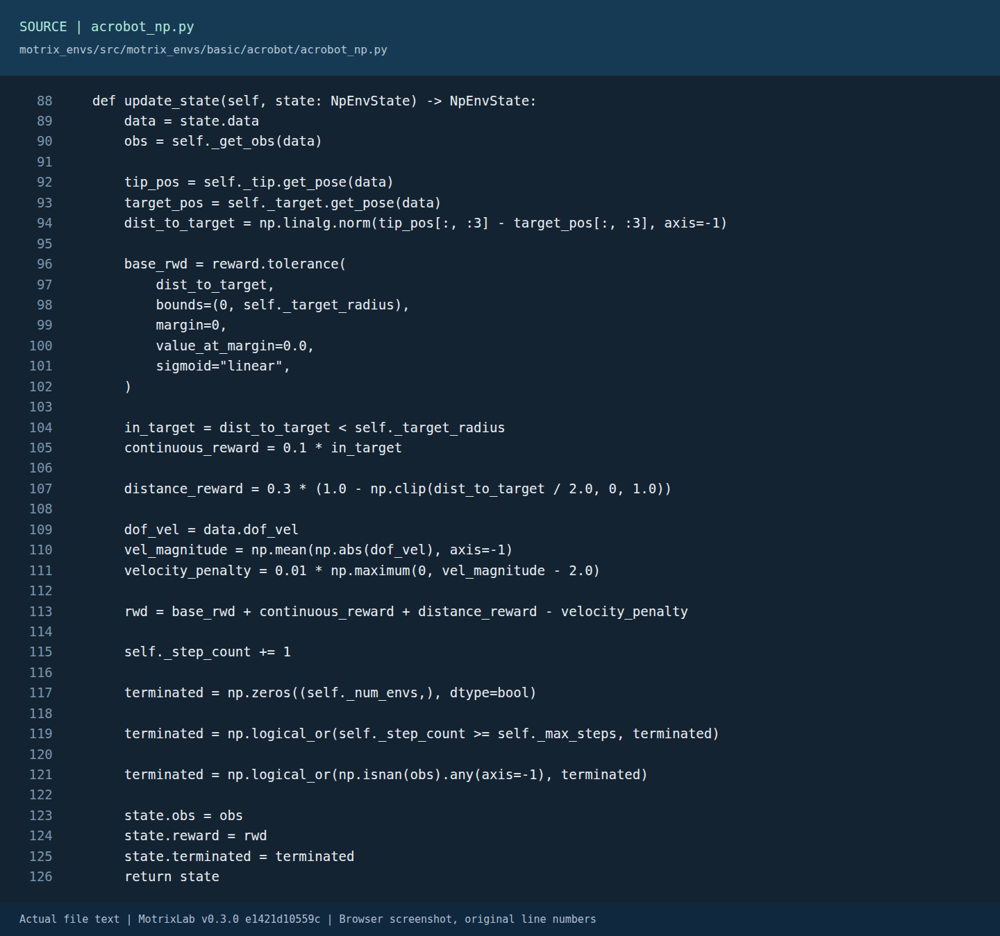

超时的代码依据及实测：基类在 `update_state()` 后增加控制步计数，再执行 `_update_truncate()`，并不会把 terminated 改为 False。Acrobot 自己的 `_step_count` 在 update_state 内达到500时就设定 terminated。将物理状态保持不变、保留原计数与任务结束逻辑的独立核验得到 C/P 的 False/True、A 的 True/True；真实策略回放也得到相同结果，见 `evidence/verification.json`。

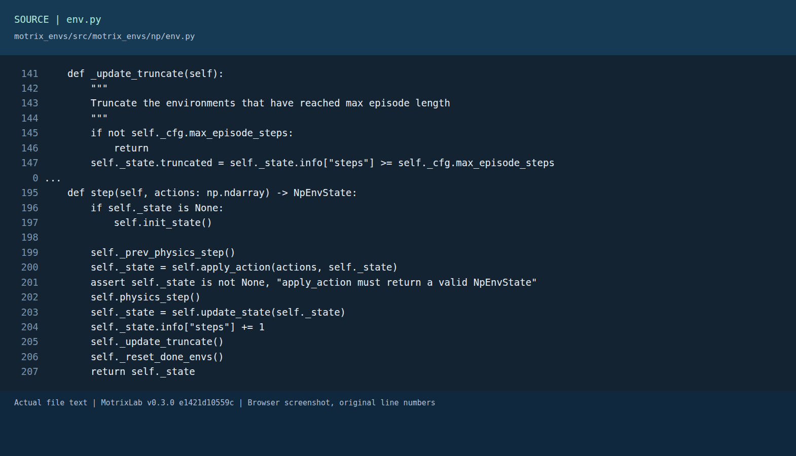

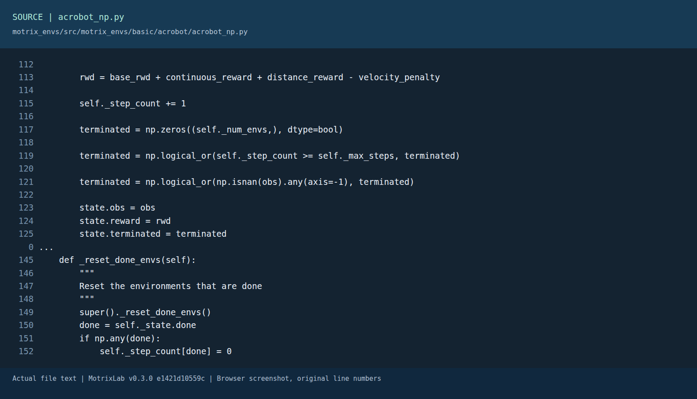

### 3. 观测编码与欠驱动（4 分）

#### 3.1 角度跨越 ±π 的具体数值

取跨越前 θ1=π−0.01=3.13159265 rad，跨越后 θ2=−π+0.01=−3.13159265 rad。实际圆周上只变化0.02 rad，但直接角度输入从 +3.13159 跳到 −3.13159，数值差约 −6.2631853 rad，容易给网络造成不连续。

| 编码 | 跨越前 | 跨越后 | 变化 |
| --- | --- | --- | --- |
| 直接角度 θ | +3.13159265 | −3.13159265 | 跳变约6.26319 |
| `[cosθ,sinθ]` | `[-0.9999500004,+0.0099998333]` | `[-0.9999500004,-0.0099998333]` | 欧氏距离约0.0199997，保持连续 |

sin/cos 保留角度的周期结构，代价是用2维编码1个角自由度；可通过 atan2(sinθ,cosθ) 恢复主值角。来源：`pendulum_np.py update_state()`；`acrobot_np.py _get_obs()`。

#### 3.2 Acrobot 的关节与直接驱动

Acrobot 有 **2个转动关节 shoulder、elbow，动作只有1维**。XML 中只有 `<motor name="elbow" joint="elbow" gear="30" .../>`，因此直接驱动的是**肘关节 elbow**；肩关节通过双连杆耦合运动间接受到影响。自由度数大于独立驱动数，因此属于欠驱动系统。

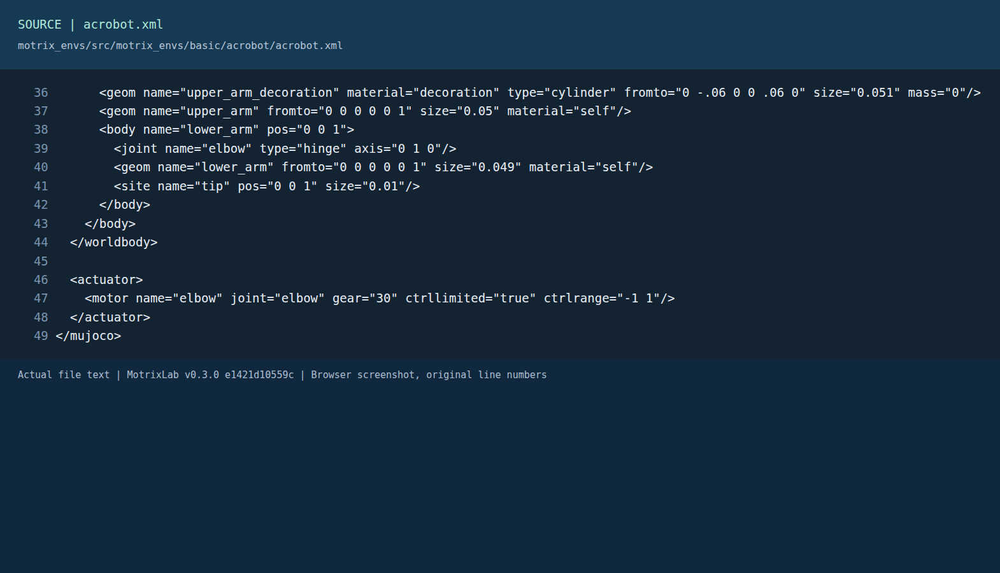

## 二、单摆能量奖励对照实验（40 分）

### 1. 能量项的代码（8 分）

来源：`motrix_envs/src/motrix_envs/basic/pendulum/pendulum_np.py update_state()` 第79–90行。

代码定义 `E=0.5ω²+(1−cosθ)`、`E*=2`；`energy_reward=tolerance(E,bounds=(2,2),margin=2,value_at_margin=0.1,sigmoid="gaussian")`。它是代码使用的无量纲塑形量，不应直接称为按真实质量、长度和重力计算的机械能（焦耳）。E=2 时能量项为1，E=0或4时为0.1。

A 组保持官方总奖励：`rA=3u+energy_reward−0.2ω²−0.001c²−0.001Δc²`，图见下方，能量项计算与加入总奖励在同一图内。


B 组仅将总奖励中这一项替换为 **`0.0 * energy_reward`**；能量计算本身及其他奖励项、观测、动作、重置、结束逻辑保持原样。修改后文件 `code/pendulum_no_energy.py` 第88行，黄色高亮为修改处。运行入口只在 `--group B` 时加载此文件。

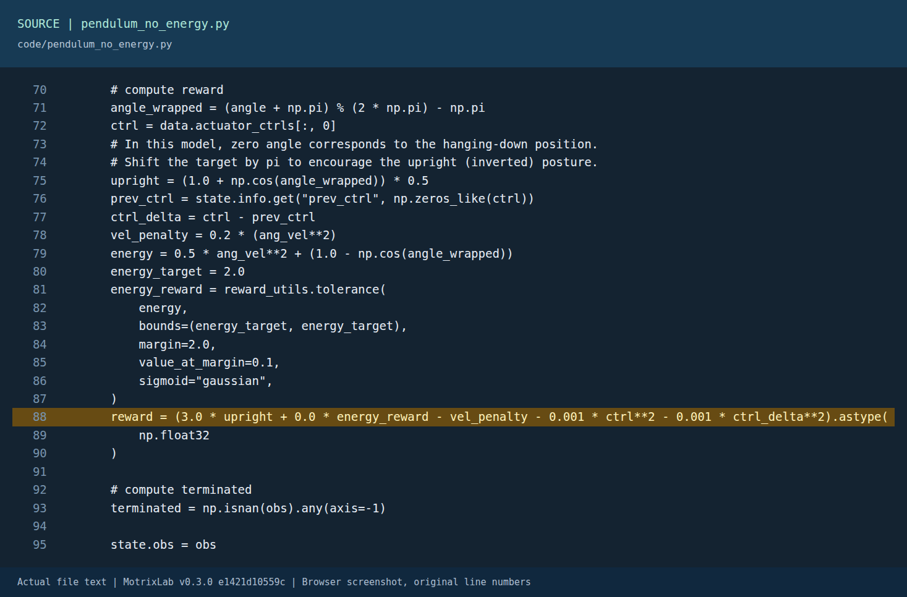

核验脚本确认 B 文件与官方文件**只有这一处字符串替换**。在相同 θ=0.8、ω=0.4、c=0.2、prev_ctrl=0 的状态，rA≈2.735089、rB≈2.512980，差值0.222108，等于独立算出的 energy_reward，见 `evidence/verification.json ab_reward_difference`。

**版本差异：**官方 Python 第73–74行注释称零角为下垂，并声称平移目标π；但 XML 的 pole 沿局部 +z 方向，hinge 绕 y 轴，公式 u=(1+cosθ)/2 在 θ=0 最大。实际正运动学也验证 θ=0 时支点 z=0.6、末端 z=1.1；θ=π 时末端 z=0.1。因此本题以真实 XML 几何定义**零角为竖直向上**，不沿用该注释，也不擅自修改奖励。

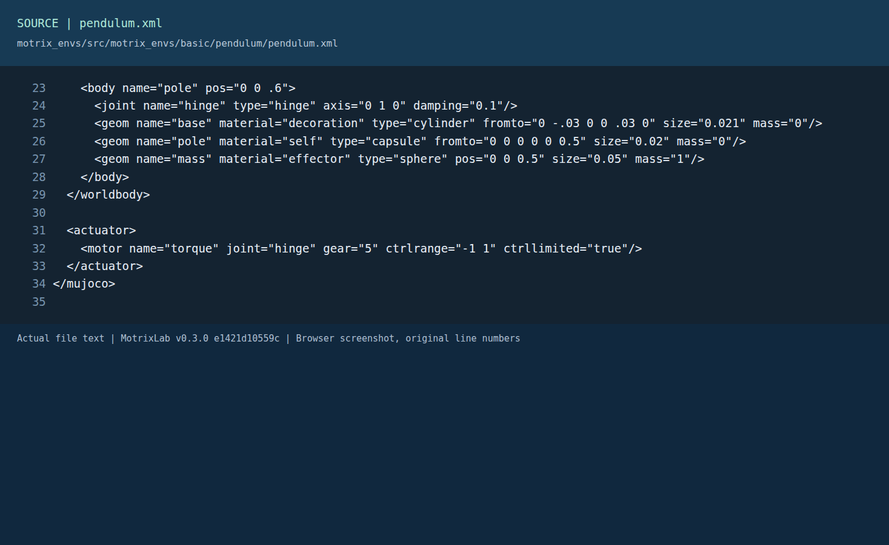

### 2. 对照参数表（8 分）

| 参数 | A 组 | B 组 | 来源 |
| --- | --- | --- | --- |
| MotrixLab版本、训练后端 | v0.3.0 / e1421d10559c；MotrixSim 0.7.0 / np；SKRL 1.4.3 PPO / Torch 2.7.0+cu128，CPU | 完全相同 | `evidence/source_manifest.json`；两组 `runs/*/manifest.json versions/device`；`code/train.py` |
| 训练种子、并行环境数 | seed=42；128环境；从头随机初始化，不加载模型 | seed=42；128环境；从头随机初始化，不加载模型 | 两组 `runs/*/config.json` 的 seed、num_envs、from_scratch；`code/train.py main()` |
| 训练步数（单位）、学习率 | 8192批量步/每环境控制步，共1048576条转移；256次更新；初始LR=3e-4，KLAdaptiveLR，kl_threshold=0.008 | 完全相同；调度规则相同，训练期间实际LR可因轨迹不同而不同 | `tasks/pendulum.py __post_init__()`、`skrl/config.py`；`code/runtime.py make_trainer()`；事件文件保留实际LR |
| 网络结构、其他奖励项系数、回合时长 | 共享策略/价值特征MLP：3→64 ELU→64 ELU，线性均值动作头及价值头，高斯可学习log_std；系数3、−0.2、−0.001、−0.001；10 s=400控制步 | 完全相同，唯一差异是能量项系数1→0 | `tasks/pendulum.py`、`skrl/config.py SkrlModelsCfg`、`skrl/torch/train/ppo.py _make_model()`；`pendulum_np.py update_state()`、`cfg.py` |

补充一致项：rollouts=32，learning_epochs=5，mini_batches=4，γ=0.99，GAE λ=0.95，ratio_clip=0.2，entropy_loss_scale=0，value_loss_scale=2，time_limit_bootstrap=True。sim_dt=0.0125 s，ctrl_dt=0.025 s，每控制步含2个物理步；输入、动作映射、每回合角度采样也相同。完整配置逐项比对已通过。

为确保记录与实际一致，运行入口在构造官方 Trainer 后直接设置运行字段。v0.3.0 的 cfg_override 会重新构造 dataclass 并调用任务的 __post_init__，可能覆盖部分传入字段；本入口绕过该字段回写问题，未修改 PPO 更新算法或任务逻辑。`config.json` 和 `manifest.json` 保存的是本次真正使用的配置。

### 3. 训练证据（6 分）

A组训练命令与结束日志见一、1.2。完整命令再次列出：

```bash
CUDA_VISIBLE_DEVICES='' .venv/bin/python -u code/train.py --env pendulum --group A --num-envs 128 --steps 8192 --seed 42
```

A组模型：`week4/runs/pendulum_A/final_agent.pt`；SHA-256：`eb9887fe5a9f4a259c413ba76d6d27cbfa7f7b98683ad7c58760e2eb5011f80f`。


B组训练命令：

```bash
CUDA_VISIBLE_DEVICES='' .venv/bin/python -u code/train.py --env pendulum --group B --num-envs 128 --steps 8192 --seed 42
```

B组模型：`week4/runs/pendulum_B/final_agent.pt`；SHA-256：`3bec62c05559a05fa23230db5a95dae383019007a9fb5cb5ba5175f354f53fc0`。

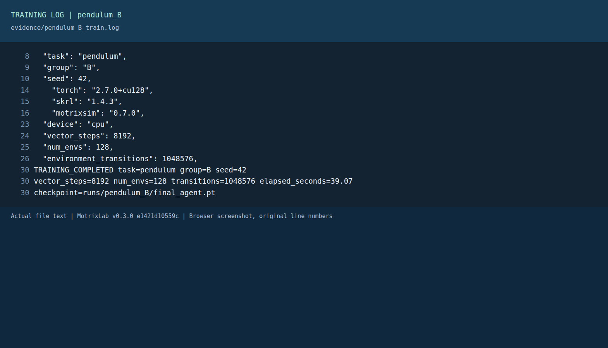

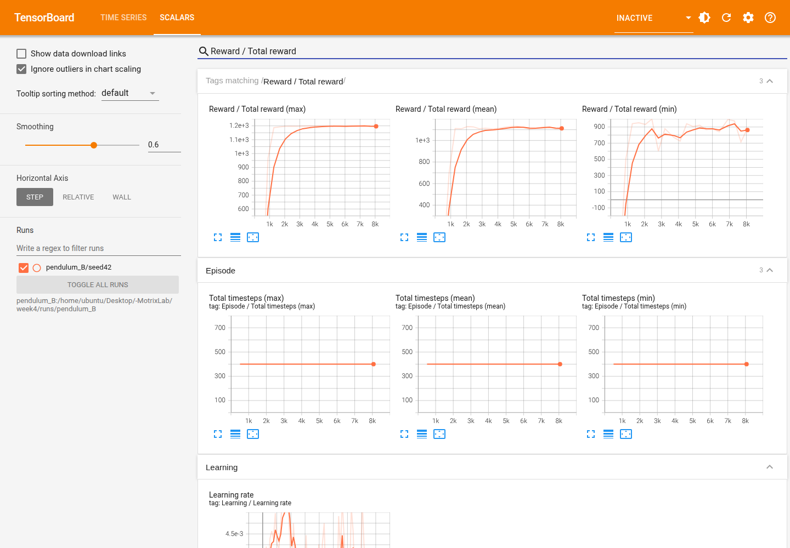

两组都使用最后更新后的模型，不按回放表现选择不同训练时刻。训练结束标记由 train() 正常返回后写入，原始日志为 `evidence/pendulum_A_train.log`、`pendulum_B_train.log`，事件、checkpoint 和配置均随作业提交。

### 4. 回放记录（10 分）

两组各回放3个完整回合，种子为0、1、2，确定性均值动作；两组同种子的初始角度严格相同，初始角速度均为0。相机位置、朝向、视场和分辨率完全相同，见各 `capture_manifest.json camera`。

```bash
CUDA_VISIBLE_DEVICES='' .venv/bin/python code/evaluate.py --env pendulum --group A --seeds 0 1 2 --policy runs/pendulum_A/final_agent.pt
CUDA_VISIBLE_DEVICES='' .venv/bin/python code/evaluate.py --env pendulum --group B --seeds 0 1 2 --policy runs/pendulum_B/final_agent.pt
.venv/bin/python code/render_replays.py --task pendulum_A
.venv/bin/python code/render_replays.py --task pendulum_B
```

判断标准：相对竖直向上的夹角 α=acos(cosθ)，**α≤15°为直立范围**。每个控制步检查，初始帧也计入“曾到达”；本次6个初始姿态均在15°以外。末帧是第400个控制步后的物理状态，明确在自动 reset 之前保存，不是 reset 后的 obs。

| 组别 / 回合 | 初始姿态（角度θ、偏离向上α） | 是否曾到达直立范围 | 末帧是否在直立范围内 | 证据时间点（仿真时间） |
| --- | --- | --- | --- | --- |
| A / 0 | θ=+17.573°，α=17.573°，ω=0 | 是 | 是，α≈6.381° | 初始0.000 s；首次0.100 s；末帧10.000 s |
| A / 1 | θ=−29.872°，α=29.872°，ω=0 | 是 | 是，α≈6.381° | 初始0.000 s；首次0.575 s；末帧10.000 s |
| A / 2 | θ=−23.042°，α=23.042°，ω=0 | 是 | 是，α≈6.381° | 初始0.000 s；首次0.375 s；末帧10.000 s |
| B / 0 | θ=+17.573°，α=17.573°，ω=0 | 是 | 是，α≈2.828° | 初始0.000 s；首次0.225 s；末帧10.000 s |
| B / 1 | θ=−29.872°，α=29.872°，ω=0 | 是 | 是，α≈2.828° | 初始0.000 s；首次0.500 s；末帧10.000 s |
| B / 2 | θ=−23.042°，α=23.042°，ω=0 | 是 | 是，α≈2.828° | 初始0.000 s；首次0.325 s；末帧10.000 s |

表中首次进入时刻来自每0.025 s的状态记录；视频以20 fps每0.05 s渲染一帧，落在两帧之间的判定可由 `seed*.npz` 精确复核。所有回合持续400步/10 s，`terminated=False, truncated=True`。视频包含t=0及t=10.000 s的末帧，编码时长约10.05 s，多出的0.05 s用于显示最后状态。

A组三个完整回合视频：

- [A / seed 0](https://github.com/Ryon-droid/-MotrixLab/blob/main/week4/videos/pendulum_A_seed0.mp4)
- [A / seed 1](https://github.com/Ryon-droid/-MotrixLab/blob/main/week4/videos/pendulum_A_seed1.mp4)
- [A / seed 2](https://github.com/Ryon-droid/-MotrixLab/blob/main/week4/videos/pendulum_A_seed2.mp4)

B组三个完整回合视频：

- [B / seed 0](https://github.com/Ryon-droid/-MotrixLab/blob/main/week4/videos/pendulum_B_seed0.mp4)
- [B / seed 1](https://github.com/Ryon-droid/-MotrixLab/blob/main/week4/videos/pendulum_B_seed1.mp4)
- [B / seed 2](https://github.com/Ryon-droid/-MotrixLab/blob/main/week4/videos/pendulum_B_seed2.mp4)

A组第一个回合末帧：偏离向上方向约 **6.38°**。下图顶栏标出由关节状态计算的角度，辅助线标示竖直参考与摆杆方向；原始无标注图另存为 `seed0_terminal_raw.png`。

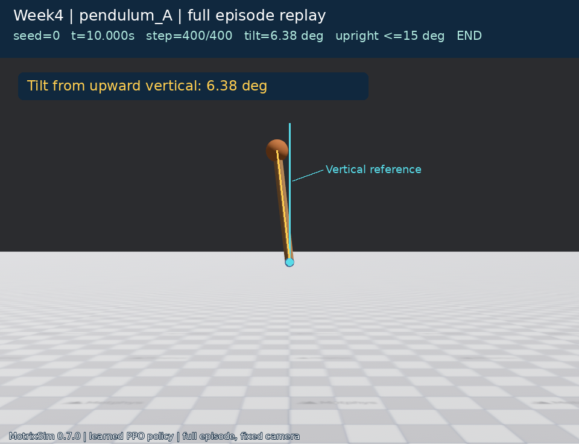

B组第一个回合末帧：偏离向上方向约 **2.83°**。

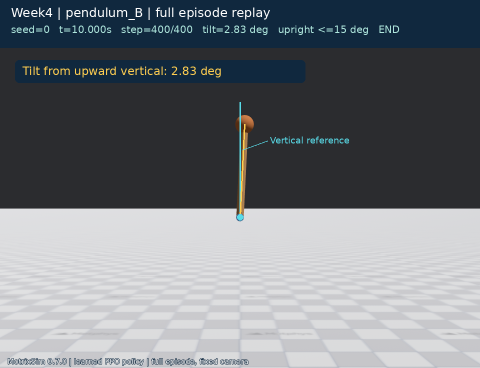

### 5. 分析（8 分）

**5.1 到达直立范围与末帧的差异。** 本次6个回合都曾进入直立范围，6个末帧也全部在15°以内，因此二元判断上没有差异。B组末帧偏角约2.83°，比A组约6.38°更小；但进入范围的速度并非B组全面更快：seed 0的A组更早，seed 1、2的B组更早。不能只用一个种子的画面概括所有情况。

从完整轨迹算出的“控制步落在直立范围的比例”（不含初始帧）如下。这个统计只描述所测回合，末帧本身不能证明整个回合稳定。

| 种子 | A组直立范围内控制步比例 | B组直立范围内控制步比例 |
| --- | --- | --- |
| 0 | 99.25% | 98.00% |
| 1 | 94.50% | 95.25% |
| 2 | 96.50% | 97.00% |

**5.2 能量奖励可能的作用。** 能量项使学习信号不只取决于姿态，还取决于 `0.5ω²+1−cosθ` 与2的差。偏离目标能量时会产生连续塑形信号，可能改变探索路径、速度和最终姿态的折中。对于本版本的真实向上零角，静止直立时 E=0，能量项为0.1，并不是其最大值1；增加速度或偏角可能让 E 接近2，却又会受到角速度和姿态项的抑制。因此该项可能改变最终控制偏置，不能机械断言“加能量奖励必然更直立”。B组仍保留系数为3的姿态奖励与速度惩罚，所以去掉能量项仍能学到接近直立的行为，与本次现象相符。

本次B组末帧更靠近竖直，与上述折中改变一致；但这只是可能解释，不足以把全部差异归因于能量项的一种具体动力学机制。两组总奖励定义不同，本报告不以总回报数值的大小判断哪个更好。

**5.3 结论局限。** 第一，只有一个训练种子42，无法排除优化随机性；应增加多个独立训练种子，再报告均值和置信区间。第二，回放只测0、1、2三个初始角，恰好都比较接近向上方向，不能代表下垂或远离直立的初始状态，更不能证明任意初始角都能摆起。第三，训练预算有限，未证明收敛；长时间扰动鲁棒性、跨模型参数泛化也未测试。第四，本实验沿用该版本的能量公式及注释/几何差异，不能直接推广到具有正确物理机械能定义的其他 Pendulum 实现。

## 三、双关节机械臂 dm-reacher 分析（25 分）

本题不训练。加载 v0.3.0 的 `dm-reacher` 环境，seed=0，打开真实 MotrixRender 窗口查看，并使用同一环境状态的固定俯视相机截图作标注。与官方 `uv run scripts/view.py --env dm-reacher` 一样调用该环境及官方 NpRenderer；本仓库提供可独立运行的最小入口：

```bash
.venv/bin/python code/view.py --env dm-reacher --seed 0
.venv/bin/python code/render_replays.py --task reacher
```

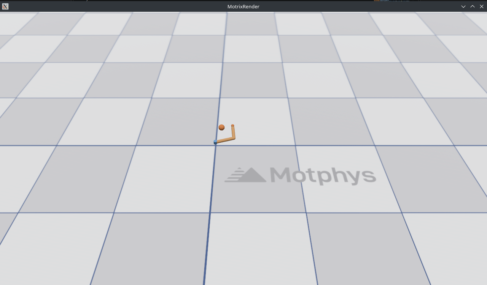

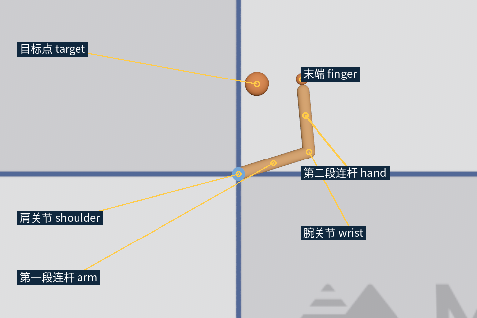

第一段连杆为 arm，第二段连杆为 hand；两受控转动关节为 shoulder、wrist；finger 是用于计算距离的末端。目标点是独立 target body，其位置由 target_x、target_y 两个滑动关节表示。末端 finger 相对 hand 的局部偏移是0.12 m，而 hand 可见 capsule 的 fromto 长0.10 m，应区分几何外形与末端坐标。

### 1. 八要素表（选做，单独评价16分）

以下路径同样省略 `motrix_envs/src/motrix_envs/` 前缀。

| 要素 | 答案 | 来源 |
| --- | --- | --- |
| 智能体 | ①控制平面双连杆机械臂，使末端 finger 接近本回合目标。②接收10维观测，输出2维连续动作，分别控制肩/腕电机；target 不是受策略控制的部件。 | `basic/reacher/reacher_np.py _get_obs()/apply_action()`；`reacher.xml actuator` |
| 环境 | ①arm、hand、finger、shoulder、wrist、target、两个目标平移关节和地面。②ReacherEnvCfg 指向 reacher.xml；NpEnv 加载，sim_dt=0.0125，ctrl_dt=0.025。 | `basic/reacher/cfg.py ReacherEnvCfg`；`reacher.xml worldbody`；`np/env.py __init__()` |
| 观测 | ①实际10维，`4 qpos + 2 to_target + 4 qvel`。②顺序为 `[q_shoulder,q_wrist,target_x,target_y,Δx,Δy,dq_shoulder,dq_wrist,v_target_x,v_target_y]`，其中 Δ=目标−末端。XML 除两旋转关节外还有目标的两滑动关节，故不是只按两关节算出的6维。 | `reacher_np.py _init_obs_space()/_get_obs()`；`reacher.xml` 的四个 joint；实测 `verification.json reacher.obs_shape=[1024,10]` |
| 动作 | ①2维连续 Box([-1,-1],[1,1])。②a0控制 shoulder、a1控制 wrist，直接写 actuator_ctrls；XML默认 gear=0.05，电机对输入限幅±1，因此转矩范围各±0.05 N·m。 | `reacher_np.py _init_action_space()/apply_action()`；`reacher.xml default/motor、actuator` |
| 奖励 | ①平面距离 d=norm(target_xy−finger_xy)，正常状态 reward=tolerance(d,(0,0.02),margin=0.02,linear)。②0≤d≤0.02 m时为1，0.02<d<0.04 m时线性降为0，d≥0.04 m时为0；NaN观测时强制0。 | `reacher_np.py update_state()`；`cfg.py target_size`；`np/reward.py tolerance()/_sigmoids()` |
| 初始状态 | ①两个机械臂角各采样U(-π,π)，目标平移量随后覆盖。②data.reset 清零初始速度，四个速度初始均0；再设置关节位置、正运动学、目标位置。初始腕角采样范围不按±160°关节限位裁剪。 | `reacher_np.py reset()`；`reacher.xml wrist range`；1024个重置样本核验 |
| 终止条件 | ①观测任一NaN时 terminated=True，奖励归0；到达目标不会提前结束。②6 s，ctrl_dt=0.025，240控制步，正常超时为 terminated=False、truncated=True。 | `reacher_np.py update_state()`；`cfg.py max_episode_seconds`；`base.py max_episode_steps`；`np/env.py _update_truncate()` |
| 域随机化 | ①每回合肩/腕角随机；target_x采样U(-0.15,0.15)，target_y采样U(0.15,0.15)。实际x有变化、范围约[-0.15,0.15)，实际y恒0.15 m，变化幅度为0，z=0。②在reset时采样，普通步不重新随机；未随机质量、长度和摩擦。1024样本x≈[-0.149978,0.149989]，y只有一个浮点值0.150000006。 | `reacher_np.py reset()`：target_x、target_y、target_dof_pos；`reacher.xml target_x/target_y`；`verification.json` |

### 2. 关键代码（15 分）

#### 2.1 观测构造：目标信息怎样进入观测

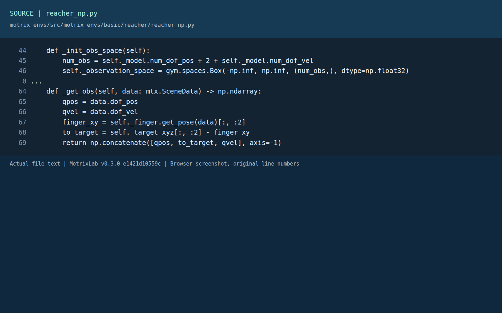

`to_target = self._target_xyz[:,:2] − finger_xy` 将目标相对末端的平面位移 Δx、Δy 显式输入；同时 qpos 包含 XML 中 target_x、target_y 两滑动关节的位置，直接泄露目标绝对坐标。因此目标信息有两条入口，不能只注意 `to_target`。来源：`basic/reacher/reacher_np.py _get_obs()`、`_init_obs_space()`。

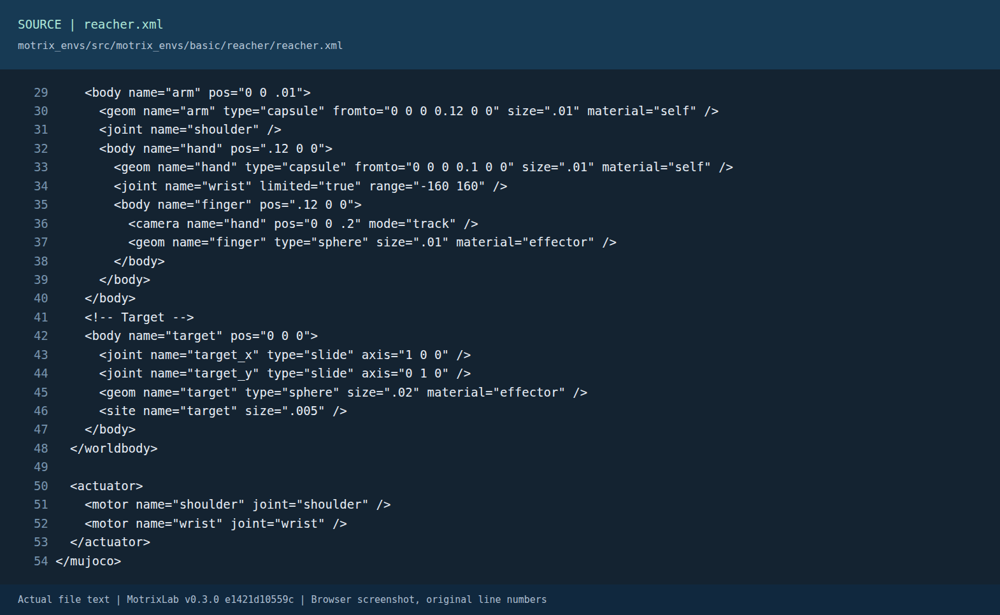

#### 2.2 动作应用：每个分量控制哪个关节

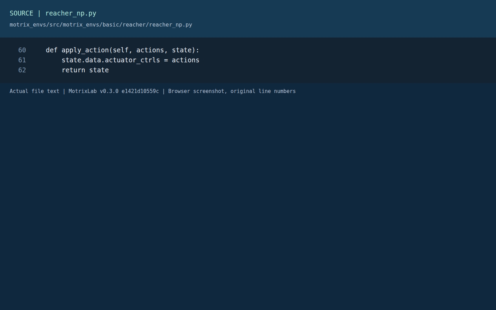

`state.data.actuator_ctrls = actions` 不在函数内交换顺序或增加执行器；XML actuator 按顺序列出 shoulder、wrist 电机，所以 `actions[:,0]` 控制肩关节 shoulder，`actions[:,1]` 控制腕关节 wrist。目标的两个滑动关节没有电机，不属于这2维动作。来源：`reacher_np.py apply_action()` 与 `reacher.xml actuator`。

#### 2.3 奖励计算：距离如何影响奖励

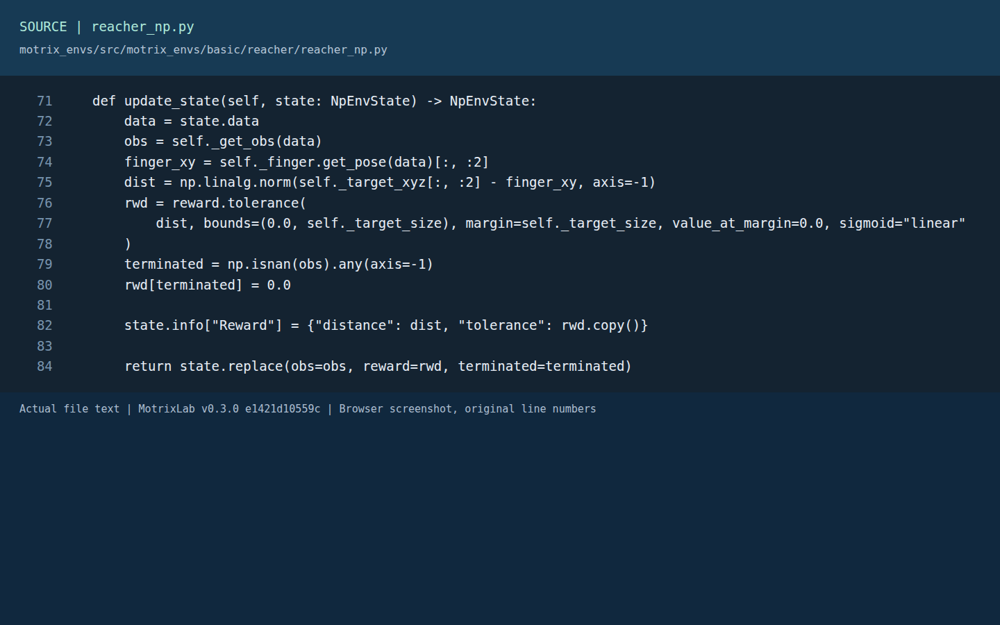

奖励使用末端 finger 的世界xy位置与目标xy位置的欧氏距离。默认 target_size=0.02 m，因此在正常有限观测下，`r(d)=1`（0≤d≤0.02 m），`r(d)=(0.04−d)/0.02`（0.02<d<0.04 m），`r(d)=0`（d≥0.04 m）。例如d=0.03 m奖励0.5，在d=0.04 m已经降为0；目标球的视觉大小不替代代码阈值。NaN观测时另外置0。

来源：`reacher_np.py update_state()`；`cfg.py ReacherEnvCfg.target_size`；`np/reward.py tolerance()/_sigmoids()`。独立代入0、0.01、0.02、0.03、0.04、0.05 m已验证为1、1、1、0.5、0、0。

### 3. 思考题（10 分）

**判断：不能仅凭不含目标信息的当前观测，可靠地到达每回合随机变化的目标。** 这里讨论默认使用当前观测的策略，不假定额外视觉、目标通信或通过奖励历史主动搜索的机制。

**原因：** 相同的机械臂关节位置和速度可以对应不同 target_x，而此时到达各个目标所需的动作通常不同。如果观测将这些情况映射为相同输入，策略就无法知道本回合应该向左还是向右修正。随机目标使目标成为决定动作所需的状态；删除信息后，问题产生部分可观测性。它可能偶然命中某个目标或到达目标分布中间的固定位置，但不能据此称为可靠到达随机目标。

**逐项代码依据：** 对实际10维向量按0起始编号检查：

| 分量索引 | 内容 | 是否须去掉及原因 |
| --- | --- | --- |
| 0、1 | shoulder、wrist角度 | 可保留，是机械臂自身状态；结合固定连杆几何可计算末端，但不能单独确定随机目标x。 |
| 2、3 | target_x、target_y的qpos | 必须去掉，直接提供目标绝对位置；只删相对位置仍会泄露目标。y虽本次恒0.15，也属于目标位置字段。 |
| 4、5 | to_target的Δx、Δy | 必须去掉，是目标−末端的相对位置；保留它们和自身状态可恢复目标位置。 |
| 6、7 | shoulder、wrist角速度 | 可保留，是自身运动状态。 |
| 8、9 | target_x、target_y的速度 | 严格去除所有目标相关分量时一并删除。这两个量在本次reset都为0，单独不直接给出目标位置，但它们属于目标关节状态，不应作为“完全不含目标信息”的输入保留。 |

因此可将观测严格改为 `[qpos[:,0:2], qvel[:,0:2]]`，即4维自身状态；还需同步改 observation_space。若任务成功率下降，不能误判为训练器损坏，而应考虑任务相关信息丢失。

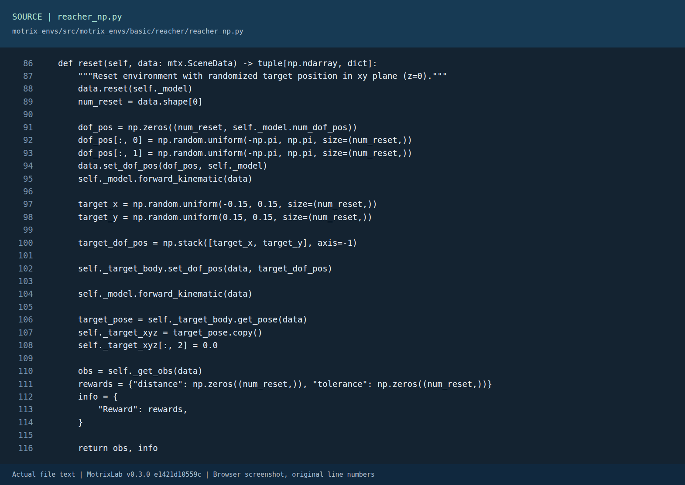

来源：`basic/reacher/reacher_np.py _get_obs()/reset()`；`reacher.xml` 的 shoulder、wrist、target_x、target_y joint。官方若按两个机械臂关节给出6维说明，则未包含本XML目标的两个额外位置和两个额外速度分量；本提交按实际拼接10维分析。

## 复现与证据索引

- 作业要求：本目录原始《（第四周）强化学习与仿真软件第五期实训营作业.pdf》。
- 最终文档：`第四周作业.pdf`；可编辑源：`answer.md`。
- 官方源码版本：https://github.com/Motphys/MotrixLab/tree/e1421d10559c825e72bab0f3cbb517c333d67e16 。源代码遵循 Apache-2.0，原版权声明、LICENSE、NOTICE 均保留。
- 模型、完整配置、训练事件：`runs/{cartpole,pendulum_A,pendulum_B,acrobot}/`。
- 回放轨迹、动作、判定与相机参数：`evidence/replay/`；视频：`videos/`，共8段。
- 源码及运行核验：`evidence/source_manifest.json`、`verification.json`；文件哈希与视频检查：`evidence/artifact_manifest.json`。
- 全部执行入口和环境安装说明：`README.md`；PDF构建：`code/build_report.py`。
